# EXP-01 — Ngắt kết nối 81 giây giữa phiên sạc

**Ngày:** 16/09/2026 · **Người chạy:** Trí (WP2) · **Trạng thái:** thăm dò, chạy một lần — chưa phải thí nghiệm chính thức.

## Bàn thí nghiệm

| Thành phần | Chi tiết |
|---|---|
| Trụ | SAP e-mobility-charging-stations-simulator **v4.12.0**, template `abb-atg` chỉnh thành `powerme-d1` (DC, 120 kW, 2 súng, MeterValues mỗi 10 s, ATG tự mở phiên 90–150 s) |
| CSMS | `lab/mini-csms.mjs` — `ocpp-rpc@2.2.1`, `strictMode`, trả lời tối thiểu hợp schema, ghi mọi frame ra JSONL kèm `received_at` (đồng hồ CSMS) và `cp_timestamp` (đồng hồ trụ) |
| Cách ngắt | Tắt tiến trình mini-CSMS lúc 14:19:01Z khi tx 3 (súng 1) đang sạc; bật lại 14:20:06Z. Trụ nối lại 14:20:22Z → **81 s mất kết nối** |
| Dữ liệu thô | `ocpp-traces/exp1-disconnect-81s.jsonl` (150 frame, gộp trace trước và sau khi bật lại) |

Chạy lại: `node lab/mini-csms.mjs` (từ `apps/csms`), rồi `NODE_ENV=production node dist/start.js` trong thư mục simulator đã build với `config.json` trỏ về `ws://localhost:9000/ocpp`.

## Kết quả — tx 3, súng 1, theo thứ tự CSMS nhận

| Nhận lúc | Bản tin | `cp_timestamp` | skew (s) | Ghi chú |
|---|---|---|---|---|
| 14:18:27 → 47 | MeterValues E = 64 → 142 → **242** Wh | live | 0,0 | trước khi ngắt |
| *14:19:01 → 20:22* | *— mất kết nối 81 s —* | | | |
| 14:20:27 → 57 | MeterValues E = 796 → 873 → 922 → **1042** Wh | live | **0,0** | tx 3 vẫn đang sạc |
| 14:20:57 | StatusNotification c1 `Finishing` | — | — | |
| 14:20:58 | **StopTransaction** `meterStop = 242`, reason Local | **14:18:52** | **125,3** | mâu thuẫn với 1042 Wh ở trên |
| 14:20 → 14:21:54 | MeterValues E = 303, 354, 367, 386, 513, 538 Wh | 14:18:57 → 14:19:47 | 127–122 | **phát lại**, 6 mẫu, đến *sau* StopTransaction | **phát lại**, đến *sau* StopTransaction |

Phía trụ (log SAP): trong lúc mất mạng đã đưa **8** MeterValues vào buffer; sau khi nối lại chỉ **6** được gửi, **2** mất không có dòng log nào. Nối lại **không gửi `BootNotification`**. Thử lại kết nối mỗi **30 s cố định** (tuyến tính, khớp spec 1.6).

## Bốn hiện tượng quan sát được

1. **Không có dấu hiệu ở tầng giao thức** để phân biệt bản tin phát lại với bản tin thời gian thực. Tín hiệu duy nhất là `received_at − cp_timestamp`: 0,0 s với live, 107–126 s với phát lại. Đây chính là khoảng trống OCPP 1.6 thừa nhận và 2.0.1 vá bằng `offline` + `seqNo`.
2. **Sai thứ tự** — mẫu cũ đến sau `StopTransaction` và sau mẫu mới hơn.
3. **Xung đột số liệu trong cùng một giao dịch** — `meterStop` = 242 Wh nhưng MeterValues live đã lên 1042 Wh. Tính tiền theo `meterStop` hay theo chuỗi MeterValues cho kết quả chênh **4,3 lần**.
4. **Mất mẫu một phần, im lặng** — 8 buffer, 6 phát lại.

## Điều KHÔNG được kết luận từ thí nghiệm này

- Hiện tượng 3 (StopTransaction mang `meterStop` cũ trong khi MeterValues vẫn tăng) nhiều khả năng là **đặc thù của SAP simulator** — spec yêu cầu `meterStop` là chỉ số tại thời điểm dừng. Firmware Ruihua có làm vậy không: **chưa biết**, phải hỏi hãng hoặc đo trên trụ thật.
- Hiện tượng 1, 2, 4 thuộc **lớp vấn đề ở tầng spec** và sẽ tồn tại trên phần cứng thật dưới dạng nào đó; mức độ cụ thể (bao nhiêu mẫu mất, thứ tự thế nào) phụ thuộc firmware.
- Chạy một lần, không có lặp lại, không có nhóm đối chứng. Số liệu ở đây là *minh hoạ hiện tượng*, không phải *đo lường*.

## Hệ quả cho thiết kế CSMS (xác nhận các ADR)

| Quan sát | ADR / quyết định |
|---|---|
| Phải có `received_at` bên cạnh `cp_timestamp` để phát hiện phát lại | ADR-0009 — lưu cả hai mốc thời gian |
| Log thô là thứ duy nhất tái dựng được chuyện gì đã xảy ra | ADR-0005 — ghi frame trước khi xử lý |
| `meterStop` và chuỗi MeterValues có thể mâu thuẫn → engine đối soát phải so cả hai và gắn cờ | BE-07 — bản ghi đối soát có trạng thái `conflict` |
| Nối lại không có Boot → phải bắt sự kiện mở socket, gán *epoch kết nối* | BE-02 — connection registry |
| Mini-CSMS khởi động lại cấp lại `transactionId = 1` → trùng tx cũ | `transactionId` phải từ DB sequence, không từ bộ nhớ |
| SAP không có `TransactionMessageAttempts` / `RetryInterval` → hành vi retry không quan sát được | Phải patch 4 khoá thiếu trước khi làm thí nghiệm chính thức (WP5) |

## Việc tiếp theo

- Patch 4 config key thiếu vào SAP, rồi lặp lại có kiểm soát: 3 kịch bản × N lần, mỗi lần cùng độ dài ngắt.
- Gửi Ruihua thêm câu: firmware gửi `Energy.Active.Import.Register` **số nguyên hay thập phân**? (SAP gửi `48.46 Wh`; ADR-0009 lưu số nguyên → cần chính sách làm tròn.)
- SteVe làm nhóm đối chứng — cùng kịch bản, xem SteVe ghi nhận tx 3 là bao nhiêu Wh.

## Sequence diagram (sinh từ log, MeterValues gộp)

```mermaid
sequenceDiagram
  participant CP as Trụ (simulator)
  participant CS as Mini-CSMS
  CP->>CS: BootNotification Ruihua D1-120
  CS-->>CP: CALLRESULT BootNotification
  CP->>CS: StatusNotification c1 Available
  CS-->>CP: CALLRESULT StatusNotification
  CP->>CS: StatusNotification c2 Available
  CS-->>CP: CALLRESULT StatusNotification
  CP->>CS: Heartbeat
  CS-->>CP: CALLRESULT Heartbeat
  CP->>CS: Heartbeat
  CS-->>CP: CALLRESULT Heartbeat
  CP->>CS: BootNotification Ruihua D1-120
  CS-->>CP: CALLRESULT BootNotification
  CP->>CS: StatusNotification c1 Available
  CS-->>CP: CALLRESULT StatusNotification
  CP->>CS: StatusNotification c2 Available
  CS-->>CP: CALLRESULT StatusNotification
  CP->>CS: Authorize idTag=UNDEFINED
  CS-->>CP: CALLRESULT Authorize
  CP->>CS: StatusNotification c1 Preparing
  CS-->>CP: CALLRESULT StatusNotification
  CP->>CS: StartTransaction c1 meterStart=0 Wh
  CS-->>CP: CALLRESULT StartTransaction transactionId=1
  CP->>CS: StatusNotification c1 Charging
  CS-->>CP: CALLRESULT StatusNotification
  CP->>CS: Authorize idTag=BB2TBR09
  CS-->>CP: CALLRESULT Authorize
  CP->>CS: StatusNotification c2 Preparing
  CS-->>CP: CALLRESULT StatusNotification
  CP->>CS: StartTransaction c2 meterStart=0 Wh
  CS-->>CP: CALLRESULT StartTransaction transactionId=2
  CP->>CS: StatusNotification c2 Charging
  CS-->>CP: CALLRESULT StatusNotification
  CP->>CS: MeterValues ×6
  CS-->>CP: CALLRESULT ×6
  CP->>CS: Heartbeat
  CS-->>CP: CALLRESULT Heartbeat
  CP->>CS: MeterValues ×12
  CS-->>CP: CALLRESULT ×12
  CP->>CS: Heartbeat
  CS-->>CP: CALLRESULT Heartbeat
  CP->>CS: StatusNotification c1 Finishing
  CS-->>CP: CALLRESULT StatusNotification
  CP->>CS: StopTransaction tx1 meterStop=601 Wh reason=Local
  CS-->>CP: CALLRESULT StopTransaction
  CP->>CS: MeterValues ×1
  CS-->>CP: CALLRESULT ×1
  CP->>CS: StatusNotification c1 Available
  CS-->>CP: CALLRESULT StatusNotification
  CP->>CS: MeterValues ×2
  CS-->>CP: CALLRESULT ×2
  CP->>CS: StatusNotification c1 Preparing
  CS-->>CP: CALLRESULT StatusNotification
  CP->>CS: StartTransaction c1 meterStart=0 Wh
  CS-->>CP: CALLRESULT StartTransaction transactionId=3
  CP->>CS: StatusNotification c1 Charging
  CS-->>CP: CALLRESULT StatusNotification
  CP->>CS: MeterValues ×3
  CS-->>CP: CALLRESULT ×3
  CP->>CS: StatusNotification c2 Finishing
  CS-->>CP: CALLRESULT StatusNotification
  CP->>CS: StopTransaction tx2 meterStop=997 Wh reason=Local
  CS-->>CP: CALLRESULT StopTransaction
  CP->>CS: StatusNotification c2 Available
  CS-->>CP: CALLRESULT StatusNotification
  CP->>CS: MeterValues ×1
  CS-->>CP: CALLRESULT ×1
  CP->>CS: Heartbeat
  CS-->>CP: CALLRESULT Heartbeat
  CP->>CS: MeterValues ×4
  CS-->>CP: CALLRESULT ×4
  CP->>CS: StatusNotification c1 Finishing
  CS-->>CP: CALLRESULT StatusNotification
  CP->>CS: MeterValues ×1
  CS-->>CP: CALLRESULT ×1
  CP->>CS: StatusNotification c2 Preparing
  CS-->>CP: CALLRESULT StatusNotification
  CP->>CS: StopTransaction tx3 meterStop=242 Wh reason=Local
  Note over CP,CS: ⚠ received_at − cp_timestamp = 125s → nghi phát lại
  CS-->>CP: CALLRESULT StopTransaction
  CP->>CS: StartTransaction c2 meterStart=0 Wh
  Note over CP,CS: ⚠ received_at − cp_timestamp = 126s → nghi phát lại
  CS-->>CP: CALLRESULT StartTransaction transactionId=1
  CP->>CS: StatusNotification c2 Charging
  CS-->>CP: CALLRESULT StatusNotification
  CP->>CS: MeterValues tx3 303.03 Wh SoC=9%
  Note over CP,CS: ⚠ received_at − cp_timestamp = 122s → nghi phát lại
  CS-->>CP: CALLRESULT MeterValues
  CP->>CS: StatusNotification c1 Available
  CS-->>CP: CALLRESULT StatusNotification
  CP->>CS: MeterValues tx3 354.41 Wh SoC=35%
  Note over CP,CS: ⚠ received_at − cp_timestamp = 114s → nghi phát lại
  CS-->>CP: CALLRESULT MeterValues
  CP->>CS: MeterValues tx3 367.34 Wh SoC=95%
  Note over CP,CS: ⚠ received_at − cp_timestamp = 107s → nghi phát lại
  CS-->>CP: CALLRESULT MeterValues
  CP->>CS: MeterValues ×1
  CS-->>CP: CALLRESULT ×1
  CP->>CS: MeterValues tx3 385.85 Wh SoC=18%
  Note over CP,CS: ⚠ received_at − cp_timestamp = 104s → nghi phát lại
  CS-->>CP: CALLRESULT MeterValues
  CP->>CS: MeterValues ×1
  CS-->>CP: CALLRESULT ×1
  CP->>CS: MeterValues tx3 513.29 Wh SoC=18%
  Note over CP,CS: ⚠ received_at − cp_timestamp = 109s → nghi phát lại
  CS-->>CP: CALLRESULT MeterValues
  CP->>CS: MeterValues ×3
  CS-->>CP: CALLRESULT ×3
  CP->>CS: MeterValues tx3 537.94 Wh SoC=41%
  Note over CP,CS: ⚠ received_at − cp_timestamp = 127s → nghi phát lại
  CS-->>CP: CALLRESULT MeterValues
```

