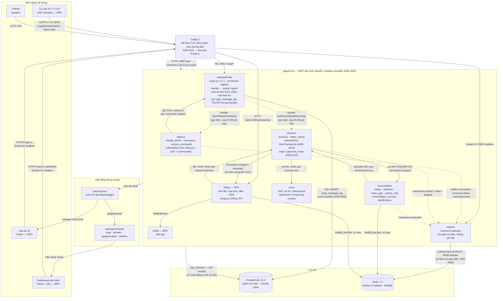

# Package diagram — CSMS backend (`apps/csms`)

**Ngày:** 23/10/2026
**Task:** T19 — package diagram cho CSMS backend
**Người chịu trách nhiệm:** Ngô Văn Minh Trí (WP2)
**Nguồn:** `docs/WP2-KIEN-TRUC-TECHSTACK.md` (nhánh `wp2/be-01-tai-lieu-kien-truc-va-tong-quan`) · `apps/csms/lab/` (nhánh `wp2/be-02-csms-ctl-tuong-tac`) · `CONTRIBUTING.md` · `README.md` · `infra/.env.example`
**Trạng thái:** **Thiết kế đích**, chưa phải hiện trạng — xem mục 4.

> Tài liệu này mô tả *gói* (NestJS module) và *luật phụ thuộc* giữa chúng. Nó không thay ADR; chỗ nào cần lý do thì dẫn số ADR trong `WP2-KIEN-TRUC-TECHSTACK.md`.

---

## 1. Package diagram

**Đọc sơ đồ:**

- Mũi tên liền (`-->`) là phụ thuộc gọi hàm hoặc giao thức mạng; mũi tên đứt (`-.->`) là **sự kiện trong tiến trình** (`@nestjs/event-emitter`) hoặc handler đã đăng ký: bên phát không import bên nghe.
- Toàn bộ **đường đi giao dịch** `StartTransaction → sessions → reconciliation → billing` nằm trong tiến trình, không chạm Redis pub/sub. Redis chỉ xuất hiện ở hai chỗ: Socket.IO adapter (fan-out giao diện, mất được) và BullMQ (job nền, có lưu bền).
- Không có module `admin`. Endpoint `/api/admin/*` nằm trong controller của từng module nghiệp vụ và được `RolesGuard` (do `users` cung cấp) bảo vệ.
- Cổng `3000` / `3001` và đường dẫn `/ocpp` khớp `CSMS_HTTP_PORT`, `CSMS_OCPP_WS_PORT`, `CSMS_OCPP_PATH_PREFIX` trong `infra/.env.example`. Dev không cần Caddy — simulator nối thẳng `ws://localhost:3001/ocpp/{serialNumber}`.
  > **Không còn đúng (26/10/2026, BM02 F35):** code đọc `OCPP_PORT` (dự phòng `CSMS_OCPP_WS_PORT`), mặc định **9000** như `docs/WP2-KIEN-TRUC-TECHSTACK.md` và `infra/staging`; không đọc `CSMS_HTTP_PORT`, `CSMS_OCPP_PATH_PREFIX` (`apps/csms/src/config.ts`). Cổng `3000` hiện là của **console vận hành** (`CONSOLE_PORT`), chưa có REST. Dev nối `ws://localhost:9000/ocpp/{serialNumber}`. Việc đổi cổng console khỏi 3000 để dành 3000 cho REST: xem phản hồi F35 trong `docs/self-review/BM02-TEAM-RESPONSE.md`.

---

## 2. Bảng mô tả gói

| Module | WP sở hữu | Trách nhiệm | Phụ thuộc vào | ADR liên quan |
|---|---|---|---|---|
| `ocpp-gateway` | WP2 | Máy chủ OCPP-J 1.6 trên `ocpp-rpc`. Giữ connection registry (identity → socket, epoch), đóng phiên cũ khi trụ nối lại cùng identity, tuần tự hoá CALL chiều vào theo từng trụ, Basic Auth từng trụ. **Ghi frame thô vào `ocpp_message_log` trước khi gọi bất kỳ handler nào**, cả chiều vào lẫn chiều ra. | Không import module nghiệp vụ nào. Chỉ biết giao diện `OcppHandler` (handler do module khác đăng ký) và bảng `ocpp_message_log`. Hỏi `stations` mật khẩu trụ qua một `StationCredentialsPort` (interface) để không phụ thuộc ngược. | ADR-0004, ADR-0005, ADR-0011, NFR-OCPP-04 |
| `stations` | WP2 | Sổ trụ và connector: `charge_points`, `connectors`, `remote_commands`. Onboarding (trả mật khẩu một lần, băm scrypt — ADR-0011 sửa 25/10), state machine trạng thái toàn trụ và từng súng, lệnh xuống trụ bất đồng bộ (`202` + `commandId`), cảnh báo offline 900 giây. Handler cho `BootNotification`, `StatusNotification`, `Heartbeat`. | `ocpp-gateway` (gửi CALL xuống trụ qua registry), `users` (RolesGuard cho `/api/admin/stations/*`). | ADR-0009 (SN vs `display_code`), ADR-0011, ADR-0012 (`free_vend_id_tag`) |
| `sessions` | WP2 | Vòng đời giao dịch sạc: `sessions`, `meter_values`. Handler cho `Authorize`, `StartTransaction`, `MeterValues`, `StopTransaction`. Idempotency `StartTransaction` theo khoá tự nhiên, gán `origin` / `payment_mode`, ghi phiên vãng lai với `idTag` lạ. Cung cấp `SessionsService` — cửa duy nhất để module khác đọc hoặc sửa giao dịch và chuỗi meter. | `stations` (tra trụ/connector), `users` (tra `rfid_cards` để phân loại thẻ). | ADR-0009, ADR-0010, ADR-0012 |
| `reconciliation` | WP2 | Engine đối soát, bật/tắt được để làm thí nghiệm ablation: phát hiện replay theo `cp_timestamp` vs `received_at` và epoch, giao dịch trùng, lỗ hổng chuỗi meter, `orphan_stop`, `unknown_id_tag`. Ghi `reconciliation_records`, sửa giao dịch qua `SessionsService`, phát `transaction.amended`. | `sessions` (đọc/sửa qua service), BullMQ (job nền). | ADR-0005 (nguồn dữ liệu là log), ADR-0006 (job bền, không pub/sub), ADR-0009, ADR-0010 |
| `billing` | **WP5** | Tính tiền khi nhận `transaction.stopped`, tính lại khi `transaction.amended`; hoá đơn và bản ghi điều chỉnh; endpoint VNPay IPN và return. **Không thu qua VNPay** cho phiên `station_wallet`; phiên `unattributed` vào dòng báo cáo riêng. | `sessions` (`SessionsService`, không truy vấn thẳng bảng), `tariffs`, `users` (chủ phiên để thu tiền), BullMQ. | ADR-0006, ADR-0008, ADR-0009 (VND `bigint`), ADR-0012 |
| `tariffs` | **WP5** | Biểu giá theo trụ/khung giờ, quản trị qua `/api/admin/tariffs/*`. Thuần dữ liệu, không nghe sự kiện OCPP. | `users` (RolesGuard). | ADR-0009 |
| `users` | WP2 | Người dùng, xác thực JWT, vai trò (driver / operator / admin), `RolesGuard` dùng chung cho mọi `/api/admin/*`. Sở hữu sổ đăng ký thẻ `rfid_cards` (online_card / wallet_card). | Không phụ thuộc module nghiệp vụ nào. | ADR-0012 (sổ thẻ) |
| `realtime` | WP2 | Socket.IO gateway tại `/realtime`, room `station:{id}` / `transaction:{id}`. Nghe sự kiện trong tiến trình và fan-out qua Redis adapter. **Không ghi DB, không gọi service nghiệp vụ**; client phải gọi lại REST khi nối lại. | Chỉ `@nestjs/event-emitter` và Redis adapter. Xác thực JWT lúc handshake qua `users`. | ADR-0006, NFR-OCPP-02 |

Bảng → module sở hữu (mỗi bảng đúng một chủ):

| Bảng | Module |
|---|---|
| `ocpp_message_log` | `ocpp-gateway` |
| `charge_points`, `connectors`, `remote_commands` | `stations` |
| `sessions`, `meter_values` | `sessions` |
| `reconciliation_records` | `reconciliation` |
| `rfid_cards`, bảng người dùng | `users` |
| bảng hoá đơn, thanh toán, biểu giá | `billing`, `tariffs` (WP5 đặt tên) |

---

## 3. Luật phụ thuộc

> **Cập nhật 26/10/2026 (BM02 F33) — luật 1, 2, 3, 10 viết lại theo code.** Bản 23/10 giả định gateway nhận handler qua đăng ký (`OcppHandler` + `DiscoveryService`) để không import module nghiệp vụ (mục 5 câu 4). Code Iteration 1 chọn cách đơn giản hơn: gateway import thẳng `SessionsService`, `ReplayDetector`, `PillarAuthService`. Không refactor trước Review 2; các luật dưới đây mô tả **đúng code hiện tại** (đọc từ `apps/csms/src/**/*.module.ts` và constructor của provider), phần còn là thiết kế đích được ghi rõ. Bảng phụ thuộc thật ở mục 3.1.

Luật chung: **mỗi bảng có đúng một module chủ; module khác muốn đọc hay ghi phải qua service của module chủ.** Lý do: WP2 đổi partition `meter_values` hoặc đổi schema `sessions` mà không làm vỡ `billing` (hợp đồng mục 4.4 của tài liệu kiến trúc).

1. **(Viết lại 26/10 theo code.)** `ocpp-gateway` import `SessionsModule`, `ReconciliationModule`, `StationsModule` và gọi thẳng: `SessionsService` (`OcppHandlers` chuyển Authorize/Start/Meter/Stop/StatusNotification; `OcppServer`/`OfflineGraceService` gọi `onStationOffline`), `ReplayDetector` (nằm ở `reconciliation/`, gateway gọi `classify` lúc frame tới), `PillarAuthService` của `stations` (kiểm Basic Auth lúc handshake). Chiều ngược lại **không có**: `sessions`, `reconciliation`, `stations` không import `ocpp-gateway`. Gateway vẫn **không** import `billing`, `tariffs`, `realtime` (chưa có trong code). Gateway ghi thẳng các bảng `ocpp_message_log`, `charge_point_connections`, và cột kết nối của `charge_points` (`is_online`, `current_epoch`, `last_message_at`, lifecycle `awaiting_connection → in_service`). Thiết kế đích ban đầu (handler đăng ký qua `OcppHandler`, `StationCredentialsPort`) **chưa làm**; chỉ làm khi cần tách gateway, không phải việc trước Review 2.

   Thứ tự bắt buộc với mọi frame: **INSERT `ocpp_message_log` → rồi mới gọi handler.** Handler ném lỗi thì log vẫn còn (ADR-0005).
2. **(Viết lại 26/10 theo code.)** Giữa `stations` và `ocpp-gateway` chiều import duy nhất là `ocpp-gateway` → `stations` (`PillarAuthService`). `stations` chưa gửi lệnh xuống trụ (BE-04 chưa làm, không có `OcppDispatchService`). Lệnh xuống trụ duy nhất hiện có là RemoteStop / ngắt socket từ `console`, đi qua `ConnectionRegistry` mà `OcppGatewayModule` export.
3. `sessions` là cửa **ghi** duy nhất vào `sessions`, `meter_values`, `session_pauses`, `session_status_history`, `connector_status_events` (và `connectors.status`). **(Viết lại 26/10 theo code.)** Chiều gọi giữa `sessions` và `reconciliation` là `sessions` → `reconciliation`: `SessionsModule` import `ReconciliationModule`, `SessionsService` gọi `ReconciliationService.evaluate/record*` rồi tự đổi `sessions.status` qua state machine. `reconciliation` **không** import `sessions` và không sửa giao dịch (không có `SessionsService.amend`). Ngoại lệ đang có với luật "mỗi bảng một chủ": `ReconciliationService.hasSessionDebit` đọc `credit_transactions` (bảng của `billing`, guard T13 #19); `console` đọc thẳng (chỉ SELECT) bảng của các module khác; `OfflineGraceService` (gateway) đọc `sessions` để biết trụ nào có phiên mở. Khi có `billing`, `billing` đọc chuỗi meter qua `SessionsService.getEnergySeries(...)` — **cấm** `billing` viết SQL vào bảng của `sessions`.
4. Đường đi giao dịch `ocpp-gateway → sessions → reconciliation → billing` là **gọi hàm và sự kiện trong tiến trình** (`@nestjs/event-emitter`). **Không có Redis pub/sub** ở bất kỳ mắt xích nào (ADR-0006). Việc nền cần retry (đối soát định kỳ, sinh hoá đơn, tạo partition tháng kế) dùng BullMQ — có lưu bền.
5. `realtime` **chỉ nghe** sự kiện trong tiến trình và đẩy ra Socket.IO. Không ghi DB, không gọi `SessionsService`/`StationsService`, không là nguồn sự thật. Mất sự kiện là chấp nhận được; client gọi lại REST.
6. `billing` và `tariffs` (WP5) được phép phụ thuộc vào `sessions`, `users`, `tariffs`. **Không** module WP2 nào import `billing` hay `tariffs`: `sessions` phát `transaction.stopped`/`amended` chứ không gọi `BillingService`. Nhờ vậy tắt `billing` (ví dụ khi chạy thí nghiệm ablation) thì phần OCPP vẫn chạy.
7. `users` không phụ thuộc module nghiệp vụ nào. Nó cung cấp `JwtAuthGuard`, `RolesGuard`, `UsersService.resolveIdTag()` cho người khác dùng.
8. Không có module `admin`. Endpoint `/api/admin/*` đặt trong controller của module sở hữu dữ liệu (ví dụ `POST /api/admin/stations` onboarding nằm trong `stations`), gắn `@Roles('admin')` + `RolesGuard`. Tránh một module "admin" phải import mọi thứ.
9. Hợp đồng ra ngoài: `openapi.json` sinh từ decorator `@nestjs/swagger` trong controller, là nguồn cho client Dart của app Flutter và cho `packages/shared/src/api/generated/`. Dashboard dùng `packages/shared`. Kiểu dữ liệu đổi ở `packages/shared` cần hai người duyệt (CODEOWNERS).
10. **(Viết lại 26/10 theo code.)** Import thực tế giữa các Nest module (A → B nghĩa là A import B): `ocpp-gateway` → `sessions`, `reconciliation`, `stations`, `db` · `sessions` → `reconciliation`, `db` · `reconciliation` → `db` · `stations` → `db` · `console` → `ocpp-gateway`, `db` · `app` → tất cả. Không có vòng. Đích khi thêm module mới: `users` → không ai · `tariffs` → `users` · `billing` → `sessions`, `tariffs`, `users` · `realtime` → `users` (guard handshake). Vòng phụ thuộc là lỗi build; `madge --circular` **chưa** có trong CI.

### 3.1 Phụ thuộc thật trong code (26/10/2026, BM02 F33)

Đọc từ `imports:` của các `*.module.ts` và constructor của provider trên `main` sau PR #48.

| Module (thư mục) | Import Nest module | Gọi service/lớp của module khác | Bảng ghi | Bảng chỉ đọc của module khác |
|---|---|---|---|---|
| `ocpp-gateway` | `db`, `sessions`, `reconciliation`, `stations` | `SessionsService`, `ReplayDetector`, `PillarAuthService` | `ocpp_message_log`, `charge_point_connections`, `charge_points` (cột kết nối) | `sessions` (`OfflineGraceService`) |
| `sessions` | `db`, `reconciliation` | `ReconciliationService` | `sessions`, `meter_values`, `session_pauses`, `session_status_history`, `connector_status_events`, `connectors.status` | `rfid_cards`, `charge_points.free_vend_tag` |
| `reconciliation` | `db` | — | `reconciliation_records` | `credit_transactions` (guard #19) |
| `stations` | `db` | — | `charge_points`, `connectors` (onboarding) | `users`, `operator_staff`, `sites` |
| `console` | `db`, `ocpp-gateway` | `ConnectionRegistry` (ngắt socket, RemoteStop), `ReplayDetector` (khởi tạo riêng để hiển thị) | — | `charge_points`, `charge_point_connections`, `connectors`, `sessions`, `meter_values`, `session_pauses`, `reconciliation_records`, `ocpp_message_log` |

`console` (bảng điều khiển vận hành cho Review 2, `src/console/`, HTTP `node:http` trên 127.0.0.1:3000, **chưa có xác thực**) không có trong sơ đồ mục 1 vì sơ đồ đó là thiết kế đích; nó có trong ARCH-1 v1.2 và PKG-1.

---

## 4. Trạng thái hiện thực (23/10/2026)

> **Superseded (26/10/2026, BM02 F36).** Bảng dưới là ảnh chụp ngày 23/10, giữ nguyên làm lịch sử. Câu "Không có mã NestJS nào" **không còn đúng**: `apps/csms/src` hiện có `ocpp-gateway`, `stations`, `sessions`, `reconciliation`, `console`, `db`. Phụ thuộc thật giữa các module: mục 3.1. Module chưa có code: `users`, `billing`, `tariffs`, `realtime` (Known Gaps G1, G16, G17 trong `docs/DESIGN-BRIEF-WP2-INPUT.md`).

Trung thực về hiện trạng, để không ai đọc sơ đồ trên rồi tưởng đã có:

| Chỗ | Có gì trên `main` | Có gì ở nhánh chưa merge |
|---|---|---|
| `apps/csms/` | `package.json` (khai báo `ocpp-rpc@2.2.1`, không có `scripts`) và `README.md` phạm vi BE-02 → BE-08. **Không có mã NestJS nào.** | — |
| `apps/csms/lab/` | Không có | Nhánh `wp2/be-02-csms-ctl-tuong-tac` (và `wp2/be-02-ban-thi-nghiem-ocpp`): `mini-csms.mjs`, `csms-ctl.mjs`, `fake-station.mjs`, `trace.mjs`, `trace-to-mermaid.mjs`, `exp-02-dat-cho.mjs`, cấu hình SAP simulator, trace EXP-01. Là **dụng cụ thí nghiệm** viết bằng ESM thuần, không phải NestJS, không có DB, không có state machine, không có đối soát. |
| `docs/WP2-KIEN-TRUC-TECHSTACK.md` | Chỉ có bản PDF (untracked) | Nhánh `wp2/be-01-tai-lieu-kien-truc-va-tong-quan` — trạng thái *Đề xuất*, 11 ADR chưa tách file. `docs/adr/` trên `main` mới có ADR-0001. |
| `packages/shared` | README mô tả cấu trúc dự kiến | — |
| Caddy | Không có trong `infra/docker-compose.yml` (chỉ Postgres, Redis, SteVe) | — |

Những gì lab **đã chứng minh được bằng log thật** và sơ đồ này kế thừa về mặt khái niệm:

- **Connection registry** `identity → { client, epoch, connectedAt }` và việc **đóng socket cũ** khi trụ nối lại cùng identity (`csms-ctl.mjs`, mã đóng 1012) — ocpp-rpc không tự làm, đúng cảnh báo ADR-0004.
- **Epoch** tăng mỗi lần kết nối; frame có `cp_timestamp` sớm hơn `epoch_opened_at` là ứng viên phát lại từ hàng đợi offline (EXP-01, 6 mẫu phát lại). Đây là nền của `reconciliation`.
- **Ghi frame thô** (`trace.mjs`, JSONL với `received_at` cạnh `cp_timestamp`) trước mọi xử lý — tiền thân của `ocpp_message_log` (ADR-0005, ADR-0009).
- `strictMode` hai chiều của ocpp-rpc chặn lệnh sai schema tại chỗ.

Những gì lab **chưa có** và sơ đồ này là thiết kế đích: tuần tự hoá CALL chiều vào theo trụ, Basic Auth, DB, mọi module nghiệp vụ, Socket.IO, BullMQ, Caddy, OpenAPI.

---

## 5. Chỗ cần Trí xác nhận

Những điểm tài liệu nguồn **khác** với danh sách quyết định đã chốt cho T19. Tôi vẽ theo quyết định đã chốt; không tự chọn ở chỗ còn mơ hồ.

1. **Tên và số module.** `WP2-KIEN-TRUC-TECHSTACK.md` mục 1 liệt kê WP2: `ocpp-gateway`, `message-log`, `charging`, `metering`, `reconciliation`, `realtime`, `stations`; WP5: `billing`, `payments`, `invoicing`. Quyết định T19 dùng: `ocpp-gateway`, `stations`, `sessions`, `reconciliation`, `billing`, `tariffs`, `users`, `realtime`. Sơ đồ này ngầm hiểu: `message-log` gộp vào `ocpp-gateway`; `charging` + `metering` → `sessions`; `payments` + `invoicing` → `billing`; `tariffs` và `users` là mới. Cần xác nhận cách gộp này và cập nhật mục 1 của tài liệu kiến trúc cho khớp.
2. **Hợp đồng với WP5 mục 4.4** ghi "billing đọc chuỗi `meter_values` qua repository của module `metering`". Với tên mới, phải đổi thành `SessionsService` của `sessions`. WP5 cần được báo vì đây là hợp đồng.
3. **Bảng `rfid_cards` thuộc `users` hay `stations`?** Tài liệu kiến trúc chỉ liệt kê bảng, không gán module. Tôi đặt vào `users` vì `rfid_cards.driver_id` trỏ tới người dùng và `users` là nơi xác thực. Nếu Trí muốn `stations` (vì người vận hành phát hành thẻ theo site) thì sửa bảng mục 2 và luật 7.
4. **Cơ chế đăng ký handler OCPP.** Để `ocpp-gateway` không import module nghiệp vụ (luật 1), tôi giả định handler đăng ký qua decorator + `DiscoveryService` (hoặc provider token). Nếu Trí định cho gateway import thẳng `StationsService`/`SessionsService` thì gateway sẽ phụ thuộc vào hai module đó và luật 1, 2 phải viết lại (và có vòng `stations ↔ ocpp-gateway` cần `forwardRef`).
5. **Billing nhận `transaction.stopped` bằng gì?** Tài liệu kiến trúc nói BullMQ cho "đối soát, sinh hoá đơn" nhưng cũng nói billing "tính tiền khi nhận `transaction.stopped`". Tôi vẽ: sự kiện trong tiến trình kích hoạt, BullMQ chỉ cho việc nền có retry. Nếu Trí muốn `sessions` đẩy thẳng job BullMQ cho billing (bền hơn khi tiến trình sập giữa chừng) thì cạnh `SE → BI` đổi thành đi qua Redis/BullMQ — vẫn đúng ADR-0006 vì BullMQ không phải pub/sub.
6. **Đường dẫn VNPay.** `infra/.env.example` đặt `VNPAY_RETURN_URL=http://localhost:3000/payment/vnpay/return` — không nằm dưới `/api/v1`. Sơ đồ ghi `/api/v1/billing/vnpay/ipn` theo logic "endpoint trong `billing`". Cần chốt đường dẫn thật với WP5 (QA-04) và sửa `.env.example` cho khớp.
7. **Onboarding trụ là `/api/v1/stations` hay `/api/admin/stations`?** Bảng REST mục 4.2 của tài liệu kiến trúc để `POST /stations` dưới `/api/v1` (dùng bởi WP4). Theo quyết định "admin API là `/api/admin/*`", tôi đặt onboarding ở `/api/admin/stations`. Cần sửa bảng 4.2 hoặc giữ nguyên tiền tố.
8. **Stack app mobile.** `README.md` và `apps/mobile/README.md` trên `main` ghi React Native / Expo; tài liệu kiến trúc và quyết định T19 ghi Flutter; nhánh `wp2/be-01-nhan-flutter-va-mo-ta-task` sửa README nhưng chưa merge. Sơ đồ vẽ Flutter theo quyết định. Nếu app dùng Flutter thì `packages/shared` (TypeScript) không dùng được từ app — app chỉ tiêu thụ `openapi.json`; sơ đồ đã vẽ như vậy, nhưng cần WP3 xác nhận công cụ sinh client Dart.
9. **Socket.IO đi cổng nào qua Caddy?** Tài liệu kiến trúc vẽ `/realtime` nhưng không ghi cổng. Tôi giả định Socket.IO gắn vào HTTP server của Nest ở `3000`. Nếu tách cổng riêng thì thêm biến `CSMS_REALTIME_PORT` vào `.env.example`.
10. **Module kỹ thuật dùng chung** (DrizzleModule, ConfigModule, pino logger, prom-client, `EventEmitterModule`) không nằm trong danh sách quyết định nên không vẽ thành node. Đề xuất gom vào một thư mục `src/infra/` (không phải module nghiệp vụ) — cần Trí gật trước khi BE-02 scaffold.
11. **`apps/csms` trên `main`** có cả `README.md` lẫn `package.json`, không chỉ `package.json` như đề bài T19 ghi. Đã ghi đúng ở mục 4.
