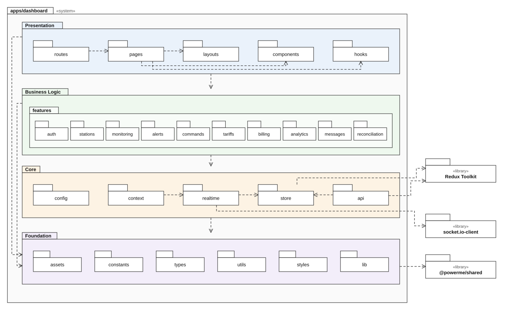

# Package diagram — Operator Dashboard (`apps/dashboard`)

**Date:** 24/10/2026 · **Owner:** WP4 · **Status:** target design (`apps/dashboard/src` not scaffolded yet)

Editable source: [`diagrams/package-diagram-dashboard.drawio`](diagrams/package-diagram-dashboard.drawio) (diagrams.net or the VS Code Draw.io extension).

**Notation:** folder = package · dashed line with open arrowhead = dependency (the source depends on the target) · «library» = external npm package.

**Layers:** Presentation → Business Logic → Core. A layer may depend only on the layers below it, never on the ones above. **Foundation** (assets, constants, types, utils, styles, lib) is the shared base, so every layer depends on it, and Foundation depends on no other layer.
