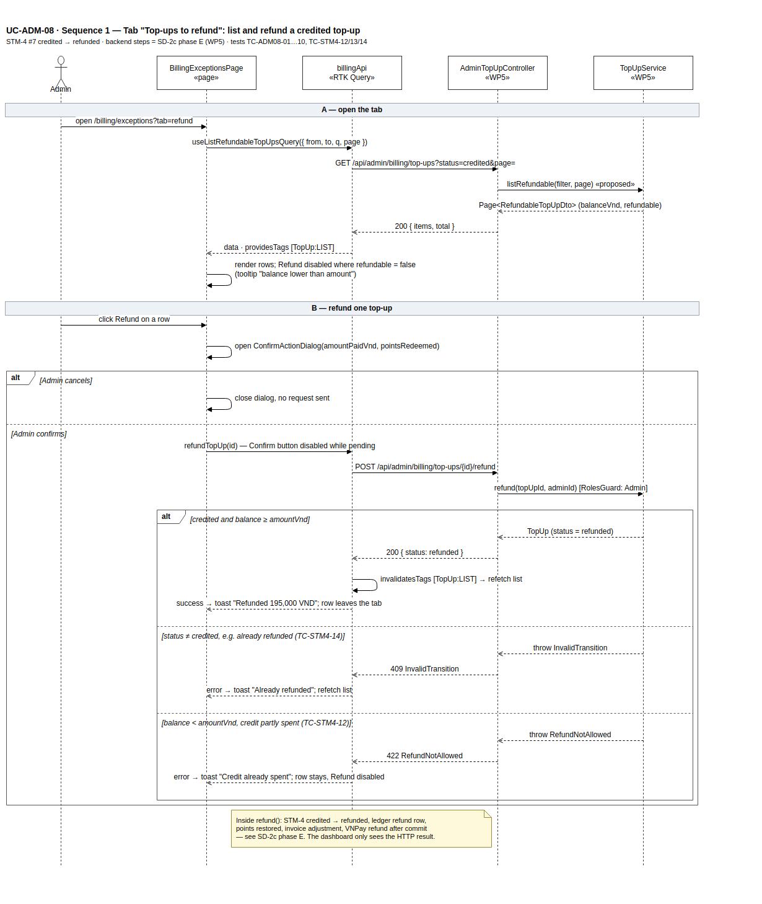
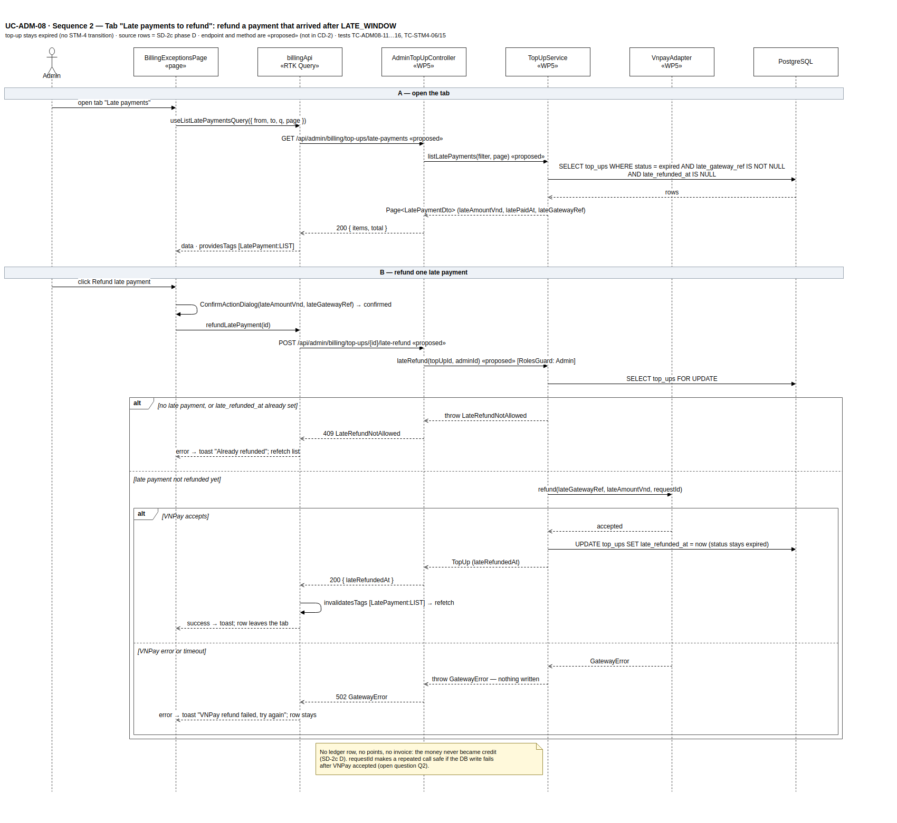
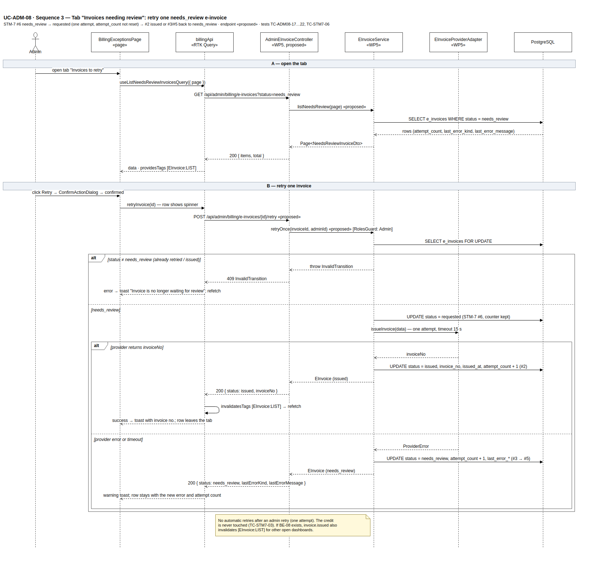
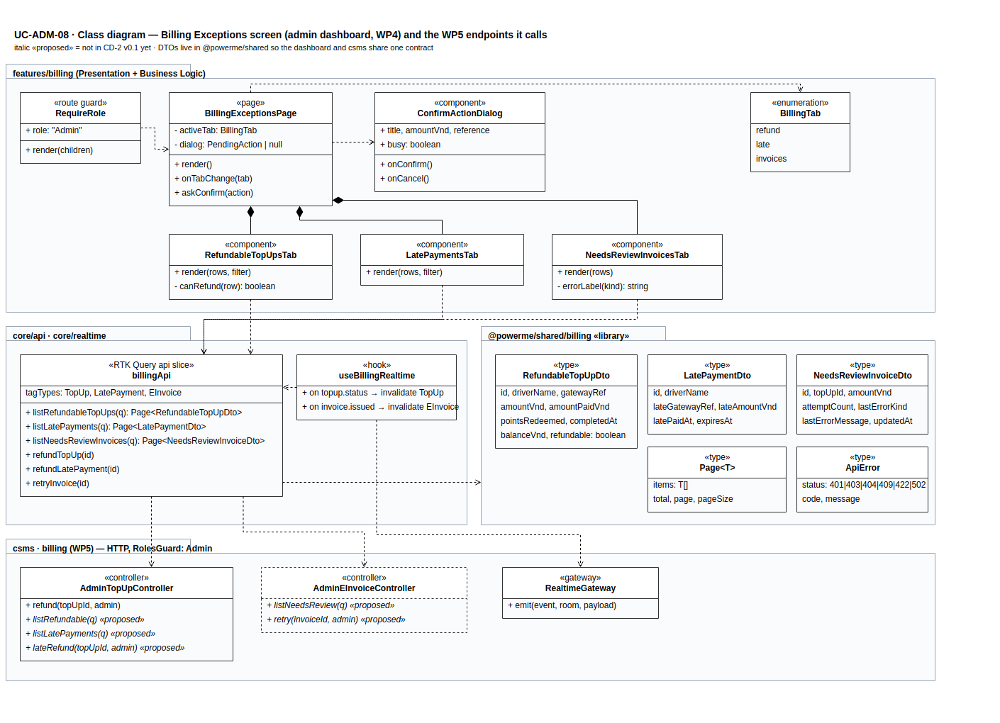

# UC-ADM-08 — Billing Exceptions screen (Admin Console): design, diagrams and test cases

**Date:** 26/10/2026 · **Area:** admin dashboard (WP4) · **Backend owner:** Lê Bảo Khang (WP5, billing) · **Status:** **DRAFT.** Scope finalised by Khang on 24/10. The layout still has to be checked against Report 3 figure 11, which is not in the repo.

**Diagrams** (draw.io in `diagrams/`; the PNGs below are previews of them):
- `uc-adm-08-seq-1-refund.drawio`
- `uc-adm-08-seq-2-late-refund.drawio`
- `uc-adm-08-seq-3-invoice-retry.drawio`
- `uc-adm-08-class.drawio`
- The dashboard package diagram (`package-diagram-dashboard.drawio` / `.svg`) now has a `billing` feature package.

**Sources:**
- WP5 billing designs, v0.1, 24/10 (repo root):
  - `CD-2_topup_classes.puml`
  - `SD-2a_create_topup.puml`
  - `SD-2b_ipn_credit_invoice.puml`, phase B
  - `SD-2c_expiry_late_refund.puml`, phases D and E
- State machines: STM-4 TopUp, STM-5 CreditAccount, STM-7 EInvoice (T12 v0.2).
- Code: `apps/csms/src/db/schema/billing.ts`, `enums.ts`.
- Dashboard: `docs/PACKAGE-DIAGRAM-DASHBOARD.md`, and FE scope in `apps/dashboard/README.md`.
- Plan: `docs/KE-HOACH-POWERME.md` (M4 01/11, M5 freeze 15/11).

> **Where things are today.**
> - `apps/dashboard` is not scaffolded.
> - The `billing` module does not exist in `apps/csms` (self-review F26). The `top_ups`, `e_invoices` and `invoice_adjustments` tables exist.
> - The columns CD-2 needs for tabs 2 and 3 are **not** in `billing.ts` yet: `late_gateway_ref`, `late_paid_at`, `late_amount_vnd`, `late_refunded_at`, `expires_at`, `points_redeemed`, `last_error_kind`, `last_error_message`. See Q6.
> - This screen is designed against the CD-2 contract and runs on mock data (MSW) until WP5 ships the endpoints.

---

## 1. What UC-ADM-08 covers

There is one route, `/billing/exceptions`, Admin only. It has three tabs. Each tab is a work queue: a row leaves the tab once the Admin has dealt with it.

| Tab | Rows shown | Admin action | State change (backend) | Backend design |
|---|---|---|---|---|
| **1. Top-ups to refund** | `top_ups.status = credited` | **Refund** (whole amount, to the original payment source) | STM-4 #7 `credited → refunded`, ledger `refund` row, points restored, `invoice_adjustments` row, VNPay refund after commit | SD-2c E |
| **2. Late payments to refund** | `top_ups.status = expired` **and** `late_gateway_ref IS NOT NULL` **and** `late_refunded_at IS NULL` | **Refund late payment** (`late_amount_vnd` back to the card) | no STM-4 transition (stays `expired`); sets `late_refunded_at`. No ledger row, points or invoice, because the money never became credit | SD-2c D, after `LATE_WINDOW` (1 h) |
| **3. Invoices to retry** | `e_invoices.status = needs_review` (3 failed attempts) | **Retry** (one attempt, `attempt_count` not reset) | STM-7 #6 `needs_review → requested`, then #2 `issued`, or #3 `failed` → #5 back to `needs_review` | SD-2b B |

**Rules the screen must respect:**
- **No partial refund.** Refund is allowed only when `balanceVnd ≥ amountVnd` (STM-4 #7 guard, TC-STM4-12/13). The UI disables the button and shows why, but the server is the authority: a 422 can still arrive if the driver spends credit while the dialog is open.
- **An invoice failure never blocks the credit** (TC-STM7-03). The retry tab only touches `e_invoices`.
- **Every money action needs an explicit confirmation** that shows the amount and the reference. The Confirm button is disabled while the request is in flight, so a double click sends one request.

---

## 2. Screen spec

Common to all three tabs:
- tab header with a count badge, taken from each list query's `total`
- date range filter and a driver / reference search (tabs 1–2)
- server paging (20 rows)
- empty state ("Nothing to handle")
- an error banner with Retry when the list fails to load
- a toast after every action, followed by a refetch

| Tab | Columns | Row action |
|---|---|---|
| 1 | Driver · gateway ref (`vnp_TxnRef`) · amount · paid (amount − points discount) · points redeemed · credited at · current balance | **Refund** — disabled with tooltip "Balance lower than the top-up amount (no partial refund)" when `refundable = false`. Confirm dialog: "Refund 195,000 VND to the original card, restore 500 points?" |
| 2 | Driver · late gateway ref · late amount · late paid at · original `expiresAt` · time since payment | **Refund late payment**. Confirm dialog shows the amount and the gateway ref |
| 3 | Invoice id · top-up id · amount · attempts · last error kind · last error message (truncated, full text on hover) · last attempt at | **Retry**. The row shows a spinner during the call. On failure the row stays with the new error and attempt count |

Layout follows Report 3 figure 11. Anything in this table that differs from the figure will be changed to match it (Q5).

---

## 3. Sequence diagram 1 — tab 1, refund a credited top-up

Editable source: [`diagrams/uc-adm-08-seq-1-refund.drawio`](diagrams/uc-adm-08-seq-1-refund.drawio).

## 4. Sequence diagram 2 — tab 2, refund a late payment

Editable source: [`diagrams/uc-adm-08-seq-2-late-refund.drawio`](diagrams/uc-adm-08-seq-2-late-refund.drawio).

## 5. Sequence diagram 3 — tab 3, retry a needs_review invoice

Editable source: [`diagrams/uc-adm-08-seq-3-invoice-retry.drawio`](diagrams/uc-adm-08-seq-3-invoice-retry.drawio).

## 6. Class diagram — dashboard side and the WP5 endpoints it calls

Editable source: [`diagrams/uc-adm-08-class.drawio`](diagrams/uc-adm-08-class.drawio).

**Dashboard folders** (package diagram):

| Class | Package | Notes |
|---|---|---|
| `BillingExceptionsPage`, the three tab components, `BillingTab` | `features/billing` | the active tab is kept in the URL (`?tab=refund\|late\|invoices`) so a link opens the right tab |
| `ConfirmActionDialog` | `components` (shared) | reused later by FE-05 remote commands |
| `RequireRole` | `routes` | `/billing/exceptions` → Admin only; other roles are redirected to `/` |
| `billingApi` | `core/api` | RTK Query `injectEndpoints`. Tags `TopUp`, `LatePayment`, `EInvoice`; each mutation invalidates its own list tag |
| `useBillingRealtime` | `core/realtime` | when BE-08 exists, `topup.status` / `invoice.issued` invalidate the tags so a second open dashboard updates too |
| DTOs, `Page<T>`, `ApiError` | `@powerme/shared` (`types`) | one contract for csms and dashboard |

---

## 7. API contract (proposal to WP5)

| # | Method + path | In CD-2 / SD-2? | Response | Errors the UI handles |
|---|---|---|---|---|
| A1 | `GET /api/admin/billing/top-ups?status=credited&from&to&q&page` | **no** — proposed `AdminTopUpController.listRefundable` | `Page<RefundableTopUpDto>` with `balanceVnd` and `refundable` computed server-side | 401, 403 |
| A2 | `POST /api/admin/billing/top-ups/{id}/refund` | **yes** — SD-2c E | `200 { status: "refunded" }` | 404 · 409 `InvalidTransition` · 422 `RefundNotAllowed` · 502 if the gateway call is made synchronously (Q2) |
| A3 | `GET /api/admin/billing/top-ups/late-payments?from&to&q&page` | **no** — proposed `listLatePayments` | `Page<LatePaymentDto>` | 401, 403 |
| A4 | `POST /api/admin/billing/top-ups/{id}/late-refund` | **no** — proposed `AdminTopUpController.lateRefund` + `TopUpService.lateRefund` | `200 { lateRefundedAt }` | 404 · 409 `LateRefundNotAllowed` · 502 `GatewayError` |
| A5 | `GET /api/admin/billing/e-invoices?status=needs_review&page` | **no** — proposed `AdminEInvoiceController.listNeedsReview` | `Page<NeedsReviewInvoiceDto>` | 401, 403 |
| A6 | `POST /api/admin/billing/e-invoices/{id}/retry` | **no** — SD-2b only says "UC-ADM-08 retry, STM-7 #6" | `200 { status: "issued", invoiceNo }` or `200 { status: "needs_review", lastErrorKind, lastErrorMessage }` | 404 · 409 `InvalidTransition` |

**Error → UI message mapping** (in `billingApi`, one place):

| Status | Message | Then |
|---|---|---|
| 401 | Session expired | go to login |
| 403 | You need the Admin role | go to `/` |
| 404 | This item no longer exists | refetch |
| 409 | "Already refunded" / "No longer waiting for review" | refetch, so the row disappears |
| 422 | Credit already spent — no partial refund | row stays, button disabled after refetch |
| 502 / network | VNPay or the invoice provider did not answer, try again | row stays |

---

## 8. Test cases

**Stack:**
- Component and integration tests: Vitest + React Testing Library, with MSW mocking A1–A6.
- `billingApi` tests: run against a real Redux store.
- End-to-end: Playwright against csms with the VNPay and e-invoice sandbox stubs. These run once WP5 ships the endpoints.

Test files sit next to the code (`*.test.tsx`), as in `apps/csms`.

### 8.1 Tab 1 — top-ups to refund

| ID | Case | Steps / data | Expected |
|---|---|---|---|
| TC-ADM08-01 | List renders | MSW A1 returns 3 rows, `total = 3` | 3 rows, badge "3", amounts formatted `195,000 ₫`, newest first |
| TC-ADM08-02 | Empty state | A1 returns `items = []` | "Nothing to handle", badge hidden |
| TC-ADM08-03 | List load fails | A1 returns 500 | error banner with Retry; Retry refetches |
| TC-ADM08-04 | Refund disabled when not refundable | row `refundable = false` (balance 100,000 < amount 200,000) | button disabled, tooltip explains "no partial refund"; no request on click |
| TC-ADM08-05 | Cancel sends nothing | click Refund → Cancel | dialog closes, 0 calls to A2 |
| TC-ADM08-06 | Confirm shows the right amount and points | row amountPaid 195,000, points 500 | dialog text has 195,000 VND and 500 points |
| TC-ADM08-07 | Refund succeeds | A2 → 200 | success toast; `TopUp` tag invalidated → A1 called again; row gone; badge −1 |
| TC-ADM08-08 | Already refunded (TC-STM4-14) | A2 → 409 | toast "Already refunded"; list refetched |
| TC-ADM08-09 | Balance spent meanwhile (TC-STM4-12) | A2 → 422 | toast "Credit already spent"; row stays; nothing else changes |
| TC-ADM08-10 | Double click | click Confirm twice fast | exactly 1 call to A2; Confirm disabled while pending |

### 8.2 Tab 2 — late payments to refund

| ID | Case | Steps / data | Expected |
|---|---|---|---|
| TC-ADM08-11 | List renders only unrefunded late payments | A3 returns 2 rows | 2 rows with late amount, late paid at, gateway ref |
| TC-ADM08-12 | Refund late payment succeeds | A4 → 200 | toast; `LatePayment` tag invalidated; row gone |
| TC-ADM08-13 | Already refunded / repeat IPN case (TC-STM4-15) | A4 → 409 | toast "Already refunded"; refetch |
| TC-ADM08-14 | Gateway error | A4 → 502 | toast "VNPay refund failed, try again"; row stays; button enabled again |
| TC-ADM08-15 | Network timeout | MSW delays past the client timeout (30 s) | same as TC-ADM08-14; no automatic retry from the client |
| TC-ADM08-16 | Tab 2 never shows tab-1 rows | A3 mock includes a `credited` row by mistake | row filtered out client-side and a console warning logged (protects the money action) |

### 8.3 Tab 3 — invoices to retry

| ID | Case | Steps / data | Expected |
|---|---|---|---|
| TC-ADM08-17 | List renders with error info | A5 returns 2 rows, `attemptCount = 3` | attempts "3", error kind shown, long message truncated with full text on hover |
| TC-ADM08-18 | Retry issues the invoice | A6 → `200 { status: issued, invoiceNo }` | toast with the invoice number; `EInvoice` tag invalidated; row gone |
| TC-ADM08-19 | Retry fails again (STM-7 #3 → #5) | A6 → `200 { status: needs_review, attemptCount: 4, lastErrorKind }` | warning toast; row stays and shows attempts 4 and the new error |
| TC-ADM08-20 | Already handled (TC-STM7-06) | A6 → 409 | toast "No longer waiting for review"; refetch |
| TC-ADM08-21 | Spinner and single request | click Retry → Confirm, slow A6 | row spinner; Retry disabled; 1 request |
| TC-ADM08-22 | Retry does not touch credit | after A6, no top-up or credit query is invalidated | only the `EInvoice` tag refetches (TC-STM7-03 from the UI side) |

### 8.4 Access, navigation and realtime

| ID | Case | Expected |
|---|---|---|
| TC-ADM08-23 | Operator (non-Admin) opens `/billing/exceptions` | redirected to `/`; billing nav item hidden |
| TC-ADM08-24 | API answers 403 (role revoked) | "You need the Admin role" and redirect |
| TC-ADM08-25 | Deep link `?tab=invoices` | tab 3 opens directly; switching tabs updates the URL |
| TC-ADM08-26 | Badges | the three badges match each list's `total` and update after actions |
| TC-ADM08-27 | Realtime (when BE-08 exists) | `invoice.issued` for a listed invoice makes the row disappear without a click |

### 8.5 End-to-end (Playwright, after WP5 delivers)

| ID | Flow |
|---|---|
| E2E-ADM08-1 | Seed a credited top-up → Admin refunds → top-up `refunded`, ledger `refund` row, `invoice_adjustments` row (checked through the csms test DB) |
| E2E-ADM08-2 | Seed an expired top-up with a late payment → refund late payment → `late_refunded_at` set, status still `expired`, no ledger row |
| E2E-ADM08-3 | Seed a `needs_review` invoice, provider stub OK → Retry → `issued`; stub failing → stays `needs_review`, attempts + 1 |

### 8.6 Trace to WP5 test cases

| WP5 test | Covered on the dashboard side by |
|---|---|
| TC-STM4-06 (late payment after window is not credited) | TC-ADM08-11, E2E-ADM08-2 |
| TC-STM4-12 / 13 (refund guard, no partial refund) | TC-ADM08-04, 09 |
| TC-STM4-14 (refund twice → InvalidTransition) | TC-ADM08-08 |
| TC-STM4-15 (repeated late IPN, nothing written) | TC-ADM08-13 |
| TC-STM7-03 (invoice failure does not affect credit) | TC-ADM08-22 |
| TC-STM7-06 (Admin retry, one attempt, counter kept) | TC-ADM08-18, 19, 20 |

---

## 9. Schedule (proposed)

| Date | Deliverable | Depends on |
|---|---|---|
| **27/10** | This doc + 4 diagrams + updated package diagram, sent to Khang for the API contract (§7) | — |
| **01/11 (M4)** | Screen working on mock data: 3 tabs, dialogs, error handling; TC-ADM08-01…27 green with MSW | dashboard scaffold (FE-01) |
| **08/11** | Wired to the real endpoints; E2E-ADM08-1…3 green | WP5 ships A1–A6 by **05/11** |
| **15/11 (M5 freeze)** | Last fixes after the review against Report 3 figure 11 | — |

---

## 10. Open questions / requests to Khang (WP5)

| # | Question | This draft assumes |
|---|---|---|
| 1 | **Endpoints A1, A3, A4, A5, A6 are not in CD-2.** Can you add `listRefundable`, `listLatePayments`, `lateRefund` (AdminTopUpController + TopUpService), and a new `AdminEInvoiceController` with `listNeedsReview` and `retry` (EInvoiceService `retryOnce`)? | Names as in the class diagram, marked «proposed» |
| 2 | **Gateway refund failing after commit** (open note in SD-2c E, `refund_status` not modelled). Does A2 return 200 as soon as the DB commits, or wait for VNPay? Same for A4, where the order is "call VNPay, then write `late_refunded_at`". If the write fails after VNPay accepted, a retry must not refund twice | A2: 200 after commit, plus a `refundStatus` field later. A4: gateway first, with an idempotent `requestId` |
| 3 | **Tab 1 content.** All `credited` top-ups, or only ones a driver asked to refund? There is no refund-request entity | All `credited` top-ups, newest first, searchable |
| 4 | **Retry synchronous or through the job?** SD-2b issues invoices through BullMQ. For an Admin button, a synchronous single attempt (timeout 15 s) gives a clear result | Synchronous (sequence 3) |
| 5 | **Report 3 figure 11.** It is not in the repo. Please send it so the columns and wording match | Layout in §2 until then |
| 6 | **Schema.** `late_*`, `expires_at`, `points_redeemed`, `gateway_ref` (`vnp_TxnRef`) on `top_ups`, and `last_error_kind` / `last_error_message` on `e_invoices`, are in CD-2 / SD-2b but not in `billing.ts`. Which migration adds them? | Migration `0001` or `0002` (WP5) |
| 7 | **Audit.** Should Admin refunds and retries be logged with the admin id (who refunded what)? | Yes — `adminId` is passed to every service call; storage to be decided |
| 8 | **Alert to Admin on `needs_review`** (SD-2b "alert to Admin"). Which realtime event name? | `billing.exception` → refresh badges |
