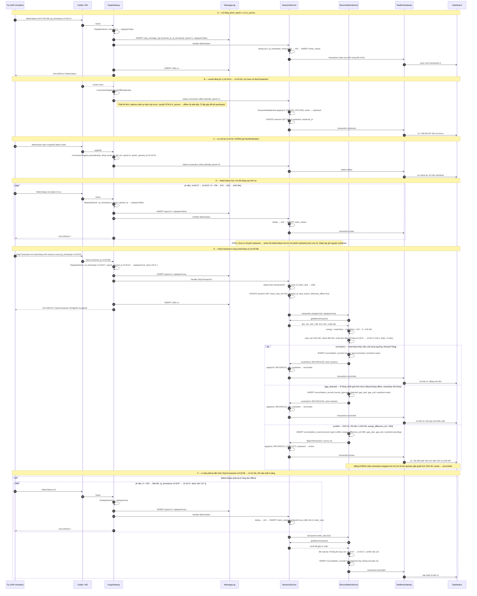
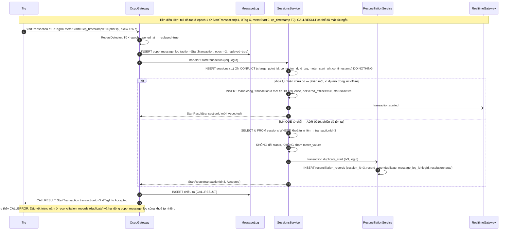
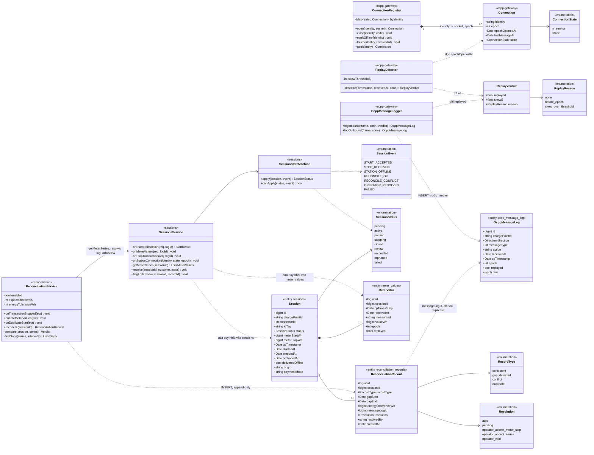

# WF-03 — Mất kết nối và đối soát: class diagram + sequence diagram

**Ngày:** 23/10/2026
**Task:** T24 — class diagram + sequence diagram cho WF-03
**Người chịu trách nhiệm:** Ngô Văn Minh Trí (WP2)
**Trạng thái:** **NHÁP — chờ T62 (đặc tả WF-03 chính thức của WP1) đối chiếu.** Đặc tả WF-03 chưa có; bản này dựng từ dữ liệu thực nghiệm EXP-01 và state machine STM-1 / STM-3. Chỗ nào T62 nói khác thì T62 thắng, sơ đồ này sửa theo.

**Nguồn:**
`apps/csms/lab/EXP-01-ngat-ket-noi-81s.md` và `apps/csms/lab/README.md` (nhánh `wp2/be-02-*`, định dạng trace `received_at` / `cp_timestamp` / `epoch` / `epoch_opened_at`) · `docs/adr/` ADR-0005, 0006, 0009, 0010 (nhánh `wp2/be-01-tach-adr-rieng`) · `docs/PACKAGE-DIAGRAM-CSMS.md` (nhánh `wp2/be-01-package-diagram-csms`) · STM-1 phiên sạc (T12, đã được T13 xác nhận) · STM-3 trụ.

> Sơ đồ mô tả **thiết kế đích** của `ocpp-gateway`, `sessions`, `reconciliation`, `realtime`. Trên `main` chưa có mã NestJS nào (xem mục 4 của package diagram). Số liệu trong note là số thật của EXP-01 — hành vi của **SAP simulator v4.12.0**, **chưa xác nhận trên firmware Ruihua**.

---

## 1. Mô tả WF-03

**Tiền điều kiện.** Trụ đã onboard và đang `in_service` (STM-3), socket OCPP-J mở với epoch kết nối `n`. Một phiên sạc đang `active` (STM-1): đã có `StartTransaction` được chấp nhận, `transactionId` cấp từ DB sequence, chuỗi `meter_values` đang tăng mỗi 10 s. Mọi frame vào/ra đã được ghi `ocpp_message_log` trước khi handler chạy (ADR-0005).

**Kích hoạt.** Socket giữa trụ và CSMS đóng (mất mạng, Caddy/CSMS khởi động lại, trụ reset) **hoặc** trụ im lặng quá 900 s. Trụ chuyển `offline` (STM-3). Mọi phiên `active` / `paused` / `stopping` trên trụ đó mà chưa có `StopTransaction` chuyển `orphaned` (STM-1). Dashboard nhận cờ "mất kết nối" qua `realtime`.

**Diễn biến khi nối lại.** Trụ mở socket mới → gateway cấp `epoch = n + 1`, ghi `epoch_opened_at`; **không chờ `BootNotification`** (EXP-01: SAP nối lại sau 81 s, không gửi Boot). Trụ gửi xen kẽ bản tin thời gian thực (skew `received_at − cp_timestamp` ≈ 0) và bản tin phát lại từ hàng đợi offline (skew ≈ độ dài ngắt, EXP-01: 104–127 s, 6 mẫu phát lại, **2/8 mẫu mất im lặng**). OCPP 1.6 không có cờ phân biệt hai loại này; CSMS suy ra bằng `cp_timestamp < epoch_opened_at` của kết nối hiện tại → `replayed = true`.

**Kết quả.** Khi `StopTransaction` (live hoặc phát lại) tới, `reconciliation` so `meterStop − meterStart` với chuỗi `meter_values` (mẫu cuối vs `meterStop`, đơn điệu tăng, lỗ hổng thời gian), ghi một `reconciliation_records` với `record_type ∈ {consistent, gap_detected, conflict}`. `consistent` / `gap_detected` → phiên `reconciled`, billing tính tiền. `conflict` → phiên `review`, billing **không** tính cho tới khi operator giải quyết (UC-OPS-05). EXP-01 là ca `conflict` điển hình: `meterStop = 242 Wh` trong khi MeterValues live đã lên `1042 Wh`, chênh **4,3 lần** — nhiều khả năng là đặc thù của SAP simulator, chưa biết firmware Ruihua có làm vậy không.

**Bất biến.** Không có bản tin nào bị mất trong bộ nhớ: log ghi trước handler. Không mắt xích nào trên đường `ocpp-gateway → sessions → reconciliation → billing` đi qua Redis pub/sub (ADR-0006); `realtime` chỉ nghe sự kiện trong tiến trình để đẩy lên dashboard/app và được phép mất sự kiện (client gọi lại REST).

---

## 2. Sequence diagram 1 — phiên đang sạc bị ngắt, `StopTransaction` phát lại mâu thuẫn

Kịch bản bám đúng tx 3 súng 1 của EXP-01. Sáu giai đoạn A–F đánh dấu bằng note; mục 5 ánh xạ từng giai đoạn sang chuyển trạng thái, bảng DB và ADR.

**Đọc sơ đồ:**

- Mũi tên `->>` là gọi hàm đồng bộ trong tiến trình hoặc frame trên dây; `-)` là sự kiện trong tiến trình (`@nestjs/event-emitter`), bên phát không chờ bên nghe. Không có mũi tên nào đi qua Redis trừ fan-out cuối `RT -) DB`.
- Bước "INSERT ocpp_message_log" luôn đứng **trước** "handler" (ADR-0005). `replayed` tính được trước khi INSERT vì `ReplayDetector` chỉ cần `epoch_opened_at` trong bộ nhớ của registry, không cần đọc DB.
- Ở giai đoạn E, gateway trả `CALLRESULT` **trước** khi đối soát chạy: đối soát là việc nội bộ, trụ không phải chờ.
- Giai đoạn F cho thấy đối soát **phải chạy lại** khi mẫu phát lại đến sau `StopTransaction` — EXP-01 chứng minh thứ tự này có thật. Mỗi lần chạy lại tạo bản ghi mới, không UPDATE bản cũ.

---

## 3. Sequence diagram 2 — `StartTransaction` phát lại trùng

Trụ gửi lại `StartTransaction` khi mất `CALLRESULT` lúc ngắt hoặc khi replay hàng đợi. CSMS phải trả **đúng `transactionId` cũ** (ADR-0010); trụ **không bao giờ** thấy lỗi, vì thấy `CALLERROR` thì trụ hoặc gửi lại mãi hoặc bỏ phiên, cả hai đều làm hỏng số liệu đo.

**Đọc sơ đồ:**

- `ON CONFLICT ... DO NOTHING` + `SELECT` lại là một giao dịch DB; hai `StartTransaction` giống nhau đến gần như đồng thời (ví dụ trụ gửi lại ngay sau timeout 60 s) vẫn chỉ sinh một phiên.
- `duplicate` không nằm trong bộ ba `{consistent, gap_detected, conflict}` của bản ghi đối soát theo yêu cầu T24; nháp này thêm nó vào `RecordType` vì package diagram liệt kê `duplicate` là một loại bản ghi của `reconciliation` và log `ocpp_message_log` là append-only nên không UPDATE được cờ trùng vào đó. Cần T62 chốt (mục 6).
- EXP-01 còn một ca khác: mini-CSMS khởi động lại cấp `transactionId = 1` cho `StartTransaction c2` phát lại, trùng với tx 1 cũ. Ở thiết kế đích không xảy ra vì `transactionId` lấy từ DB sequence — đó là nhánh "khoá tự nhiên chưa có" của sơ đồ.

---

## 4. Class diagram — `reconciliation` và phần liên quan của `sessions`, `ocpp-gateway`

Chỉ ghi thuộc tính và phương thức có ý nghĩa với WF-03; không liệt kê getter/setter, không liệt hoá đủ cột. Chú thích `<<...>>` là module sở hữu hoặc bảng DB tương ứng.

**Đọc sơ đồ:**

- `ocpp-gateway` không import `sessions` hay `reconciliation`: `SessionsService.onStartTransaction/onMeterValues/onStopTransaction` là handler đăng ký qua giao diện `OcppHandler` (luật 1 của package diagram). `onStationConnection` nghe sự kiện `station.connection` do `stations` phát sau khi chuyển STM-3.
- `ReplayDetector` thuộc `ocpp-gateway` vì cần `epoch_opened_at` ngay lúc frame tới, trước khi INSERT log. `reconciliation` **đọc lại** cờ `replayed` từ `meter_values` / `ocpp_message_log`, không tính lại.
- `SessionStateMachine.apply` là nơi duy nhất đổi `status`; `SessionsService.resolve` và `flagForReview` chỉ bọc lại các sự kiện `RECONCILE_OK` / `RECONCILE_CONFLICT` / `OPERATOR_RESOLVED` để `reconciliation` không phải biết bảng chuyển trạng thái.
- `ReconciliationService.enabled` là công tắc ablation (thí nghiệm WP5): tắt đi thì mọi sự kiện bị bỏ qua, phiên `closed` không bao giờ thành `reconciled`.
- `Resolution` liệt kê ba hành động operator **giả định** cho UC-OPS-05 — chưa có nguồn, xem mục 6.

Bảng chuyển trạng thái `SessionStateMachine.apply` dùng trong WF-03 (STM-1, trích phần liên quan):

| Từ | Sự kiện | Đến | Ghi chú |
|---|---|---|---|
| `active` / `paused` / `stopping` | `STATION_OFFLINE` | `orphaned` | socket đóng hoặc 900 s im lặng, chưa có StopTransaction |
| `active` / `paused` / `stopping` | `STOP_RECEIVED` | `closed` | đường bình thường, không mất kết nối |
| `closed` | `RECONCILE_OK` | `reconciled` | consistent hoặc gap_detected |
| `closed` | `RECONCILE_CONFLICT` | `review` | conflict |
| `orphaned` | `RECONCILE_OK` | `reconciled` | StopTransaction phát lại tới và đối soát xong |
| `orphaned` | `RECONCILE_CONFLICT` | `review` | **nháp thêm**, STM-1 chưa có — xem mục 6 |
| `orphaned` | `OPERATOR_RESOLVED` | `reconciled` | operator giải quyết phiên orphaned không bao giờ có StopTransaction |
| `review` | `OPERATOR_RESOLVED` | `reconciled` | UC-OPS-05 |

---

## 5. Bảng ánh xạ — bước trong sequence → chuyển trạng thái → bảng DB → ADR

| Sơ đồ / giai đoạn | Bước | STM-1 (phiên) | STM-3 (trụ) | Bảng DB bị ghi | ADR |
|---|---|---|---|---|---|
| 1 / A | MeterValues live, epoch 1 | `active` giữ nguyên | `in_service` | `ocpp_message_log` (vào + ra), `meter_values` | 0005, 0009 |
| 1 / B | socket đóng, registry đánh dấu offline | `active` → `orphaned` | `in_service` → `offline` | `sessions.status, orphaned_at`; `charge_points` (do `stations`, ngoài sơ đồ) | 0006 (sự kiện trong tiến trình, không pub/sub) |
| 1 / C | trụ nối lại, epoch 2, không Boot | `orphaned` giữ nguyên | `offline` → `in_service` | không ghi bảng nghiệp vụ; `ocpp_message_log` chỉ ghi khi có frame | 0004 (registry đóng socket cũ) |
| 1 / D | MeterValues live cho phiên orphaned | `orphaned` giữ nguyên (**xem mục 6**) | `in_service` | `ocpp_message_log`, `meter_values` | 0005, 0009 |
| 1 / E | StopTransaction phát lại, replayed=true, dedup theo transactionId | `orphaned` → (`reconciled` \| `review`) | `in_service` | `ocpp_message_log` (replayed=true), `sessions.meter_stop_wh, stopped_at, delivered_offline, status`, `reconciliation_records` | 0005, 0009 (`delivered_offline`, hai mốc thời gian), 0006 |
| 1 / F | 6 MeterValues phát lại sau Stop, đối soát lại | `review` giữ nguyên (hoặc `reconciled` nếu lần đầu là consistent và lần sau phát hiện conflict → cần T62) | `in_service` | `ocpp_message_log`, `meter_values` (replayed=true), `reconciliation_records` (bản ghi mới) | 0005 (append-only), 0009 |
| 2 / nhánh mới | StartTransaction phát lại, khoá tự nhiên chưa có | `pending` → `active` | `in_service` | `ocpp_message_log`, `sessions` (delivered_offline=true) | 0009, 0010 |
| 2 / nhánh UNIQUE | StartTransaction phát lại, khoá tự nhiên đã có | không đổi | `in_service` | `ocpp_message_log` (vào + ra), `reconciliation_records` (duplicate) | 0010, 0005 |
| ngoài sơ đồ | operator giải quyết review (UC-OPS-05) | `review` → `reconciled` | — | `sessions.status`, `reconciliation_records.resolution, resolved_by`; `billing` nhận `transaction.amended` | 0006 (BullMQ cho tính lại tiền), 0009 (VND bigint) |

Bảng nào do module nào ghi (nhắc lại từ package diagram): `ocpp_message_log` chỉ `ocpp-gateway`; `sessions` (tên bảng theo STM-1, package diagram gọi là `transactions` — cần thống nhất tên) và `meter_values` chỉ `sessions`; `reconciliation_records` chỉ `reconciliation`. `reconciliation` sửa phiên qua `SessionsService`, không viết SQL vào `sessions`.

---

## 6. Chỗ chờ T62 / cần xác nhận

Những điểm nháp này **tự chọn** vì chưa có đặc tả; T62 chốt thì sửa sơ đồ theo.

| # | Câu hỏi | Nháp này chọn | Ai chốt |
|---|---|---|---|
| 1 | **Ngưỡng skew** `received_at − cp_timestamp` cho tiêu chí phụ của replay detection. EXP-01 cho live 0,0 s và phát lại 104–127 s, nhưng chỉ chạy một lần. | Tiêu chí chính là `cp_timestamp < epoch_opened_at` (không cần ngưỡng). Tiêu chí phụ `skewThresholdS` để trống, đề xuất 30 s (bằng chu kỳ retry của trụ) chờ WP5 đo lặp. | WP1 (T62) + WP5 |
| 2 | **Timeout orphaned**: phiên `orphaned` bao lâu không có StopTransaction thì chuyển sang operator (`orphaned → reconciled` qua operator)? STM-1 ghi chuyển nhưng không ghi thời hạn. | Chưa đặt. Đề xuất job BullMQ quét mỗi giờ, phiên orphaned quá 24 h thì đẩy vào hàng chờ review. | WP1 |
| 3 | **Operator giải quyết review bằng hành động gì** (UC-OPS-05)? | Enum `Resolution` giả định ba hành động: chấp nhận `meterStop`, chấp nhận chuỗi MeterValues, huỷ phiên. Chưa có nguồn. | WP1 + WP4 (giao diện) |
| 4 | **Có gửi `RemoteStopTransaction`** khi trụ nối lại mà phiên orphaned vẫn đang sạc (giai đoạn D)? | Không gửi, để trụ tự kết thúc. Lý do: EXP-01 cho thấy trụ vẫn gửi StopTransaction sau đó; gửi RemoteStop sẽ làm nhiễu phép đo. Nhưng về nghiệp vụ có thể cần dừng để chặn sạc không tính tiền được. | WP1 |
| 5 | **`duplicate` có là `record_type` của `reconciliation_records` không**, hay chỉ là cờ ở nơi khác? Yêu cầu T24 cho bộ ba `{consistent, gap_detected, conflict}`; package diagram liệt kê `duplicate`, `orphan_stop`, `unknown_id_tag`. | Thêm `duplicate` vào enum. | Trí (BE-07) + T62 |
| 6 | **Tên bảng phiên**: STM-1 gọi `sessions`, package diagram và ADR-0010 gọi `transactions`. | Sơ đồ dùng `sessions` theo STM-1. | WP1 (ERD) |
| 7 | **Đối soát lại khi mẫu phát lại đến sau StopTransaction** (giai đoạn F): có được đổi kết luận từ `reconciled` về `review` không? STM-1 không có `reconciled → review`. | Chỉ thêm bản ghi, không đổi trạng thái nếu đã `reconciled`. Nếu T62 muốn cho phép thì thêm chuyển `reconciled → review`. | WP1 |
| 8 | **Ngưỡng năng lượng** `energyToleranceWh` để coi `meterStop` "khớp" mẫu cuối (mẫu cuối luôn đi trước thời điểm dừng tối đa một chu kỳ 10 s). | Chưa đặt. | Trí + WP5 |
| 9 | **Epoch sống ở đâu khi CSMS khởi động lại.** EXP-01 là ca CSMS chết chứ không phải trụ mất mạng: registry trong bộ nhớ mất sạch, epoch đếm lại từ 1. | Epoch phải lấy `MAX(epoch) + 1` từ `ocpp_message_log` (hoặc cột riêng trong `charge_points`) khi mở socket, không đếm trong RAM. | Trí (BE-02) |

### EXP-01 so với STM-1 — chỗ chưa khớp

1. **Phiên orphaned vẫn đang sạc.** STM-1 chỉ có lối ra `orphaned → reconciled`. EXP-01 giai đoạn D: trụ nối lại và gửi MeterValues live cho tx 3 đang orphaned — phiên thực tế vẫn `active` trên trụ. Hoặc thêm chuyển `orphaned → active` khi có MeterValues live (`replayed = false`) tới, hoặc coi `orphaned` là cờ cạnh `status` chứ không phải trạng thái. Nháp này giữ `orphaned` và ghi mẫu bình thường.
2. **Orphaned rồi conflict.** STM-1 chỉ có `closed → review`. EXP-01 là ca orphaned + StopTransaction phát lại + conflict. Nháp thêm `orphaned → review` (sơ đồ 1 nhánh conflict). Phương án khác: `orphaned → closed` khi Stop tới rồi `closed → review` — thêm một bước nhưng giữ STM-1 nguyên.
3. **"900 s im lặng" không quan sát được trên EXP-01** vì ngắt chỉ 81 s và socket đóng ngay. Chuyển `active → orphaned` trong sơ đồ dựa vào vế "socket đóng"; vế timeout chưa có bằng chứng.
4. **Trụ online lại nhưng phiên vẫn orphaned 36 s** (14:20:22 → 14:20:58): dashboard sẽ thấy trụ xanh, phiên đỏ, MeterValues vẫn chạy. STM-1 không nói dashboard nên hiển thị gì ở khoảng này.
