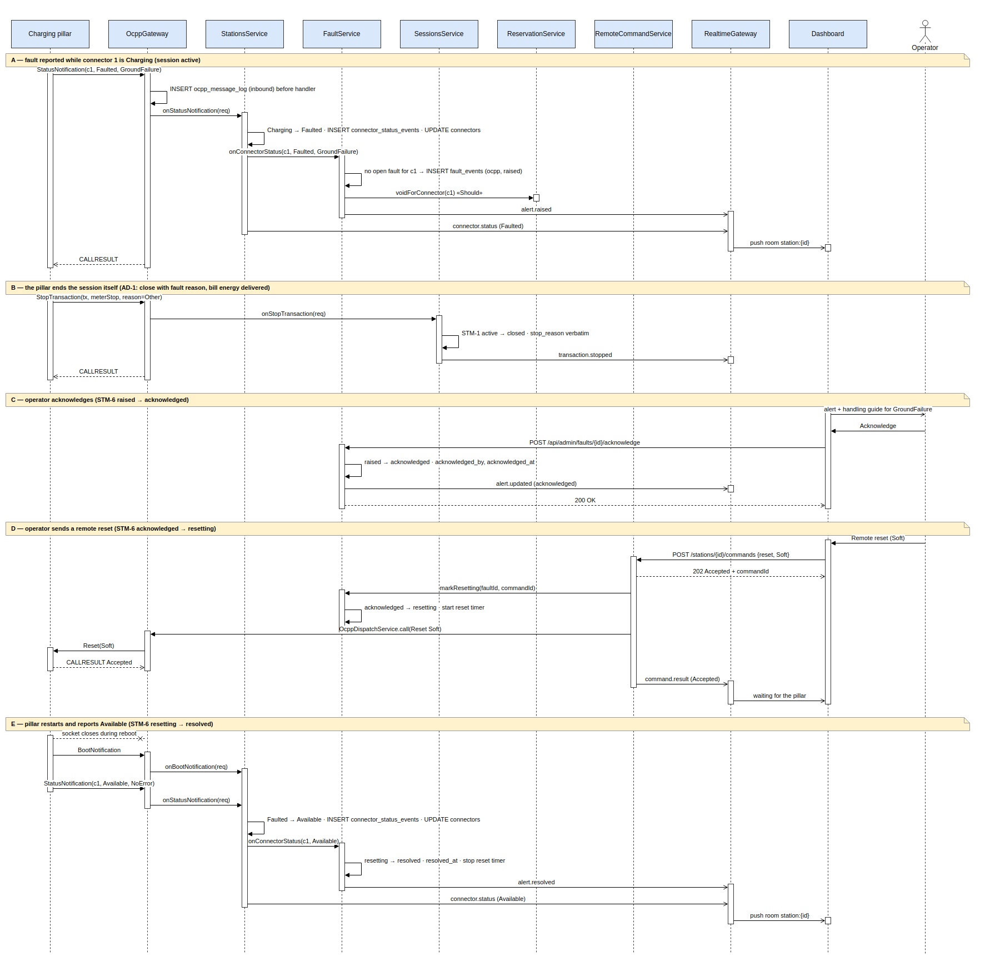
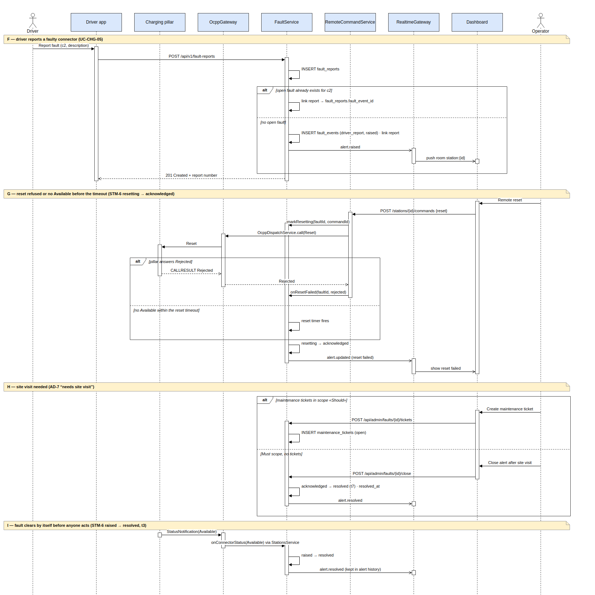
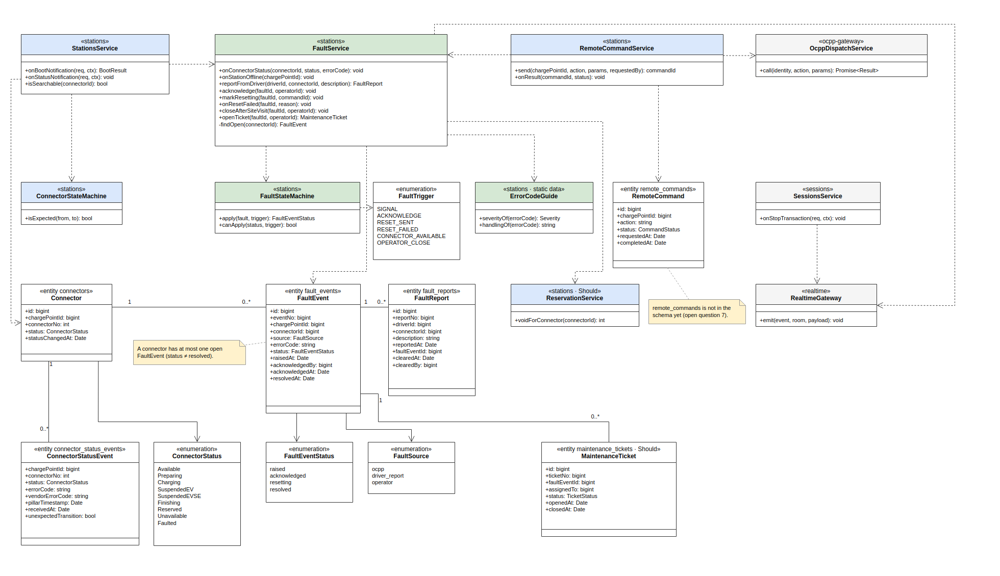

# WF-04 — Xử lý lỗi trụ (pillar fault, alert and remote recovery): sequence diagram + class diagram

**Date:** 24/10/2026
**Diagrams:** three draw.io files in `diagrams/` (`wf-04-seq-1.drawio`, `wf-04-seq-2.drawio`, `wf-04-class.drawio`); the PNGs below are previews of them.
**Iteration 1 (code + tests, FE-04):** [`ITERATION-1-WF04.md`](ITERATION-1-WF04.md).
**Status:** **DRAFT.** Built from AD-7 v1.0 and the T12 state machines (v0.2). Where AD-7 and STM-6 disagree, both are shown and the point is listed in section 6. If WP1 changes AD-7 or STM-6, those documents take precedence and these diagrams follow.

**Sources:**
`AD-7_fault_and_alert.png` (AD-7 v1.0, WP1, 05/10/2026) · STM-6 FaultEvent, STM-2 Connector, STM-3 ChargingPillar, STM-1 ChargingSession (T12 v0.2, 20/10/2026) · `docs/XAC-NHAN-STATE-MACHINE-T13.md` · `docs/THIET-KE-CSDL-VAT-LY.md` §3.7 · `apps/csms/src/db/schema/ops.ts`, `stations.ts`, `enums.ts` · `docs/PACKAGE-DIAGRAM-CSMS.md` · `docs/WP2-KIEN-TRUC-TECHSTACK.md` §4.2–4.3 · `simulator/d1-hmi/hmi-actions.mjs` (`fault` / `clearfault`).

> The diagrams show the **target design**. **Iteration 1 (FE-04, 27/10/2026)** implements the OCPP-driven part: `OcppHandlers` passes every `StatusNotification` to `SessionsService` and then to `FaultService` (`apps/csms/src/stations/faults/`), and the console sends the Reset. `remote_commands` exists since migration `0001`; `fault_events.reset_command_id` was added in migration `0007`. Driver reports, tickets, hiding the connector, the 900 s signal and realtime events are not built yet — see `ITERATION-1-WF04.md` §8.

---

## 1. WF-04 description

**Precondition.** The pillar is onboarded and `in_service` (STM-3). Its connectors report OCPP statuses (STM-2). An Operator is signed in to the dashboard. A charging session may or may not be running on the affected connector.

**Trigger** (AD-7, first decision; STM-6 t1). One of three fault signals:
1. **The pillar reports a connector `Faulted`** (UC-INT-04): a `StatusNotification` with `status = Faulted` and an OCPP `errorCode` such as `GroundFailure`.
2. **A driver reports a faulty pillar from the app** (UC-CHG-05): a `fault_reports` row.
3. **The pillar is silent for 900 s** (STM-3 t4). This branch is **WF-03**; WF-04 only takes over from the point where the alert is raised.

**Flow.**
1. The platform records the signal. If a session is running on a `Faulted` connector, the session is closed with a fault reason and the energy delivered is billed (AD-1, STM-1 `active → closed`).
2. The connector is hidden from search and suggestions, and its reservations are voided (AD-4, «Should»).
3. One `fault_events` row is created with status `raised`, and the Operator is notified.
4. The Operator acknowledges the alert (UC-OPS-03), then either:
   - sends a remote reset (UC-OPS-04), or
   - decides a site visit is needed.

**Outcome.**
- If the connector reports `Available` again, it is shown in search and the alert becomes `resolved`. This can happen after a reset (STM-6 t5) or on its own (STM-6 t3).
- If the reset is refused, times out, or the connector is still `Faulted`, the alert returns to `acknowledged` (STM-6 t6). The Operator then opens a maintenance ticket (UC-OPS-08, «Should») or closes the alert after the site visit (STM-6 t7).

**Invariants.**
- Every inbound frame is written to `ocpp_message_log` before any handler runs (ADR-0005).
- CSMS **mirrors** connector status. It never rejects a `StatusNotification`; an unexpected transition is flagged in `connector_status_events.unexpected_transition` (T13).
- A connector has **at most one open fault event** (`status <> 'resolved'`). A repeated `Faulted` or a second driver report is attached to the open event, not turned into a new one.
- A fault never blocks billing of energy already delivered.

---

## 2. Sequence diagram 1 — connector faults during a session, operator recovers it with a remote reset

The scenario matches the simulator test (`smoke.mjs`): connector 1 reports `GroundFailure`. Phases A–E are marked with notes, and section 5 maps each phase to state transitions and DB tables.

> **Message order.** The diagram shows `StatusNotification Faulted` before `StopTransaction`. The simulator sends them the other way round (`StopTransaction reason Other` first). Both orders are valid and both are tested (IT-1a / IT-1b in `ITERATION-1-WF04.md`).

Editable source: [`diagrams/wf-04-seq-1.drawio`](diagrams/wf-04-seq-1.drawio).

---

## 3. Sequence diagram 2 — alternative paths: driver report, failed reset, site visit

Editable source: [`diagrams/wf-04-seq-2.drawio`](diagrams/wf-04-seq-2.drawio).

---

## 4. Class diagram — the `stations` fault components and the parts of `sessions` and `ocpp-gateway` they touch

The diagram shows only the attributes and methods that matter for WF-04. `<<...>>` names the owning module or the DB table. Fault tables belong to `stations` (`ops.ts` header, package diagram rule "one owner per table").

Editable source: [`diagrams/wf-04-class.drawio`](diagrams/wf-04-class.drawio).

---

## 5. Mapping table — sequence step → AD-7 node → state transition → DB table

| Diagram / phase | Step | AD-7 node | STM-6 (fault) | STM-2 (connector) | STM-1 (session) | Tables written | UC |
|---|---|---|---|---|---|---|---|
| 1 / A | `StatusNotification Faulted` | Mark connector Faulted · Hide connector · Raise fault alert | ● → `raised` (t1) | Operational → `Faulted` (t14) | — | `ocpp_message_log`, `connector_status_events`, `connectors`, `fault_events`, `reservations` («Should», `voided`) | UC-INT-04 |
| 1 / B | Pillar sends `StopTransaction` | Close session with fault reason and bill energy (AD-1) | — | (stays `Faulted`) | `active` → `closed` (t10) → `reconciled` (t12) | `ocpp_message_log`, `sessions` (`stop_reason`, `meter_stop_wh`, `status`) | UC-CHG-03, UC-PAY-02 |
| 1 / C | Operator acknowledges | Receive fault alert | `raised` → `acknowledged` (t2) | — | — | `fault_events` (`acknowledged_by`, `acknowledged_at`) | UC-OPS-03 |
| 1 / D | Remote reset sent | Send remote reset · Send reset command | `acknowledged` → `resetting` (t4) | — | — | `remote_commands` (not created yet), `ocpp_message_log` (outbound) | UC-OPS-04 |
| 1 / E | Pillar reboots and reports `Available` | Restart and report status · Show connector as Available · Close alert | `resetting` → `resolved` (t5) | `Faulted` → `Available` (t15), via `Unavailable` after reboot | — | `connector_status_events`, `connectors`, `fault_events` (`resolved_at`) | UC-OPS-04, UC-INT-04 |
| 2 / F | Driver reports a fault | Record driver's fault report | ● → `raised` (t1), or linked to the open event | — | — | `fault_reports`, `fault_events` | UC-CHG-05 |
| 2 / G | Reset rejected or timed out | still faulted or offline | `resetting` → `acknowledged` (t6) | stays `Faulted` | — | `fault_events`, `remote_commands` | UC-OPS-04 |
| 2 / H | Site visit: ticket or manual close | Create maintenance ticket | stays `acknowledged` (ticket) or → `resolved` (t7) | — | — | `maintenance_tickets` («Should»), `fault_events` | UC-OPS-08 |
| 2 / I | Fault clears by itself | *(no node in AD-7)* | `raised` → `resolved` (t3) | `Faulted` → `Available` (t15) | — | `connector_status_events`, `connectors`, `fault_events` | UC-INT-04 |
| outside the diagrams | Pillar silent 900 s | Mark pillar offline (AD-2) | ● → `raised` (t1) | — | `active` → `orphaned` (t13) — see WF-03 | `charge_points.lifecycle`, `fault_events` | NFR-OCPP-07 |

---

## 6. Open questions

| # | Question | This draft assumes | Who decides |
|---|---|---|---|
| 1 | **The four error codes in the hardware SRS** and the handling guide for each (FE-04 acceptance criterion) | `ErrorCodeGuide` is a static table keyed by OCPP `errorCode`; FE-04 filled all 16 codes with Iteration 1 hints, four flagged `pendingWp1` until the SRS handling arrives | WP1 (SRS) + Nghĩa |
| 2 | **Does the pillar always send `StopTransaction` when a connector faults mid-session?** If not, who closes the session? | The pillar sends it (phase B). If it doesn't, the session waits for the STM-1 session timeout and becomes `orphaned` (WF-03) | Trí + vendor / WP5 (simulator) |
| 3 | **Reset timeout value** for `resetting → acknowledged` (open in STM-6) | A timer per fault: `FAULT_RESET_TIMEOUT_S`, default 120 s (reboot + Boot + StatusNotification), built in FE-04 | Nghĩa |
| 4 | **Manual close in Must scope** (STM-6 t7, open point 3 of AD-7) | Allowed when tickets are out of scope (diagram 2, phase H) | Nghĩa |
| 5 | **AD-7 has no self-clearing path or explicit "acknowledge" step**, while STM-6 has t2 and t3. AD-7 also goes from a failed reset straight to the ticket, while STM-6 goes back to `acknowledged` | Follow STM-6: acknowledge is an explicit action, self-clearing is allowed, and a failed reset returns to `acknowledged` | WP1 (Ân) aligns AD-7 and STM-6 |
| 6 | **`Faulted → Unavailable`** (confirmed in T13) is missing from STM-2 v0.1. A fault must also resolve when the connector reaches `Available` through `Unavailable` | Resolve on the first `Available` after `Faulted`, whatever is in between | WP1 (STM-2 v0.3) |
| 7 | **Link between a fault and its reset command.** ~~`fault_events` has no column for it, and `remote_commands` does not exist~~ **Done:** `remote_commands` (migration `0001`) and `fault_events.reset_command_id` (migration `0007`, FE-04) | — | Trí, Nghĩa (done) |
| 8 | **New realtime events** `alert.updated` and `alert.resolved` are not in the WP2 §4.3 contract (only `alert.raised` is) | Add both to `packages/shared/src/realtime` | Trí + Nghĩa (wp1 + wp2 review) |
| 9 | **Admin endpoints** `/api/admin/faults/{id}/acknowledge`, `/close`, `/tickets` and `/api/v1/fault-reports` are not in the WP2 §4.2 table | Endpoints live in the `stations` controllers with `RolesGuard` (package diagram rule 8) | Trí + Nghĩa |
| 10 | **Which module handles `StatusNotification`.** Code: `SessionsService.onStatusNotification`. Package diagram: `stations` (BM02 F33) | Diagrams use `StationsService` (target design) | Trí |
| 11 | **Severity** values and whether some codes should disable the pillar automatically (STM-3 `disabled`) | No automatic disable; severity only orders the alert list | WP1 + Nghĩa |
