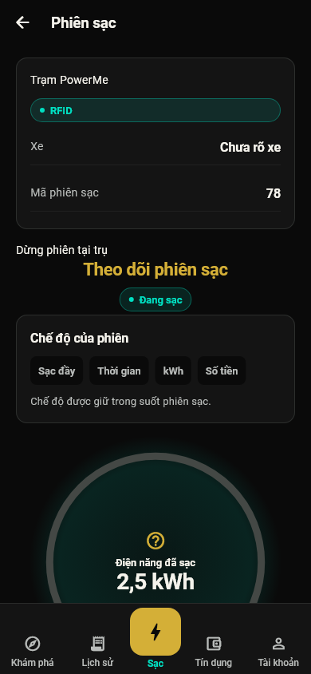
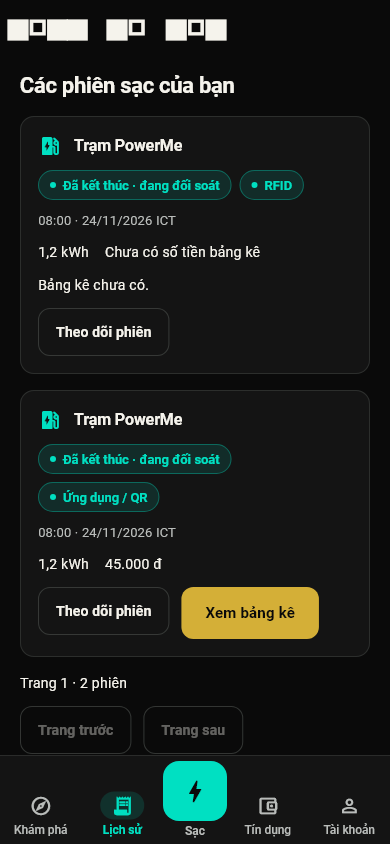

# T146 — owned driver-session discovery: backend handoff

Sequential status, 24/11: the backend-only handoff below records **phase 2 historically**. Phase 3 now integrates Flutter locally; the earlier “Flutter not started” statements describe phase 2, superseded by [phase 3 status](#phase-3--local-flutter-integration-2411) below. Deployment/device/physical-reader verification and T148 remain pending.

## Approved slice and implementation

The user approved “Bổ sung API rồi nối Flutter”. This sequential slice implements **backend API + canonical contract only**. The accepted USB reader slice is preserved byte-for-byte. Flutter will follow the primary agent's separate bounded plan/research; T148 RFID settlement remains deferred. No migrations, dependencies, authorization/card-registry behavior, billing, credits, loyalty, payment or OCPP commands are changed.

The approved plan is implemented in three parts:

1. `GET /api/driver/v1/sessions?view=active|all&page=1&page_size=20`, using the existing authenticated driver listener and DB active-driver check. Ownership comes only from the principal; no driver/tag filters. The helper parses an allowlist of single query keys with strict decimal bounds (page ≤100000, page_size ≤100). Invalid, duplicate and unknown keys return 400 `invalid_input`; other methods return 405 `Allow: GET, OPTIONS`; existing CORS preflight remains 204 without bearer.
2. One parameterized PostgreSQL CTE statement returns count and page under one MVCC snapshot, including an empty page beyond the end. Stable order is `received_started_at DESC,id DESC`. All owned origins are read without intent/ledger dependence. Active means `meter_stop_wh IS NULL` plus status `pending|active|paused|stopping|orphaned|review`. No new index is needed for this slice; the existing driver_id index remains.
3. List and progress share capability SQL in the sessions layer. Progress adds `origin`, `payment_mode`, `can_stop`, `statement_available` and preserves existing fields. Eligibility does not promise stop success: POST rechecks and its behavior is unchanged. RFID without an app intent still receives 404 on POST stop.

## Contract for Flutter handoff

Canonical OpenAPI is now **0.15.0**; see [Driver API §5](../api/DRIVER-API-HOP-DONG.md#5-phiên-không-do-app-tạo--t146-openapi-0150-24112026) and [OpenAPI](../api/driver-api.openapi.yaml).

List envelope: `{items,total,page,page_size}`. Every item has exactly:

| Fields | Meaning/type |
|---|---|
| `session_id`, `connector_id` | Positive bigint decimal strings, never JavaScript Number |
| `status` | Existing session status enum |
| `origin` | `app_qr`, `rfid`, `hmi_password`, `free_vend` |
| `payment_mode` | `csms_billed`, `unattributed` |
| `can_stop` | True only for app_qr + same-driver app intent + null meter_stop_wh + active/paused/orphaned |
| `statement_available` | Actual statement matching session and driver exists, and payment_mode is csms_billed |
| `started_at`, `stopped_at`, `updated_at` | ISO UTC; first two use received timestamps; stopped_at nullable |
| `energy_wh` | Stored final Wh, safe integer/null; no synthetic zero or live estimate |
| `amount_vnd` | Only actual owned `charging_statements.amount_vnd` for csms_billed; safe integer/null. No estimate or sessions.total_cost_vnd fallback |
| `settlement_state` | Existing settlement-job state/null; no job created by GET |
| `connector_no` | Existing connector number |
| `charge_point_display_code` | Existing display code/null; the DB permits unknown |
| `site_id`, `site_name` | Bigint string/null and string/null |
| `vehicle_id`, `vehicle_label` | Bigint string/null and stored plate_number/null, joined only for the same owner |

RFID sessions with no vehicle keep null even when the driver has a default vehicle. Another owner's vehicle is never returned. No UID/id_tag/card ID, charge-point serial or private credential is exposed. Values outside the safe integer range fail with a sanitized server error rather than being rounded. Unknown energy/amount remains null. `amount_vnd` enables real all-origin history after Flutter integration; credit ledger remains its existing credit API.

The prior wallet wording in Driver API §5 is explicitly superseded: station_wallet was removed under BR-P08/T110. This slice does not restore it or assert that RFID charging is settled. Card administration remains an authorized Admin process; no card registry is populated here.

## Research supplied before implementation

Primary completed source/test/license research before authorizing this feature. The worker records that supplied research here; it did not independently repeat the external review. No external source code was copied.

| Source and pin | Reviewed implementation and fit | Decision/tradeoffs |
|---|---|---|
| [SteVe](https://github.com/steve-community/steve/tree/d5a5d1e6d1d717279c369e88cbe1bb3c533efc93), GPL-3.0, maintained master `d5a5d1e6d1d717279c369e88cbe1bb3c533efc93` (reported push 23/11/2026) | [TransactionsRestController.java](https://github.com/steve-community/steve/blob/d5a5d1e6d1d717279c369e88cbe1bb3c533efc93/src/main/java/de/rwth/idsg/steve/web/api/TransactionsRestController.java), [TransactionQueryForm.java](https://github.com/steve-community/steve/blob/d5a5d1e6d1d717279c369e88cbe1bb3c533efc93/src/main/java/de/rwth/idsg/steve/web/dto/TransactionQueryForm.java), [TransactionRestControllerTest.java](https://github.com/steve-community/steve/blob/d5a5d1e6d1d717279c369e88cbe1bb3c533efc93/src/test/java/de/rwth/idsg/steve/web/api/TransactionRestControllerTest.java). GET lifecycle filters ACTIVE/ALL/STOPPED and 400 validation assertions are useful comparisons. | Its operator/tag-filter security model does not fit driver-principal ownership. Reuse only API/lifecycle concepts; do not copy GPL code, expose tag filters or add Java/Spring dependencies. |
| Existing PowerMe `driver-credit.ts`, `charges.http.ts`, `DriverChargingService.progress/stop`, isolated driver-discovery runner | Existing principal auth, HTTP errors, bigint handling, pagination bounds and real HTTP/JWT/OCPP test patterns fit this repository. | Adapt project-specific code; share capability SQL in the sessions module, keep money/commands out of the read path. Use one count/page statement to avoid the existing ledger's separate beyond-end count snapshot. No broad refactor of legacy routes. |

Earlier SAP/onscan/Node RFID research belongs to the reader slice only; it is not claimed as research for this backend discovery endpoint.

## Verification and remaining limits

Focused unit tests cover strict parsing (including encoded LF/CR), default/boundary pagination, invalid/duplicate/unknown inputs, null and safe-integer handling. New integration tests use real HTTP, signed JWT and a **fresh isolated PostgreSQL database**, testing owned active/stopped RFID without ledger/intent, app coexistence, ownership/unattributed filtering, bigint IDs beyond 2^53, stable ties, empty/out-of-range pages, statement/vehicle ownership, amount provenance, new progress metadata, RFID stop 404, capability states, authentication, methods and no GET writes/commands. The existing driver-charges suite is preserved and run separately with real OCPP.

The new suite is registered in `apps/csms/scripts/test-driver-discovery.mjs` for the existing isolated CI workflow. Test guards require explicit opt-in, loopback and a generated test database name, and refuse nonempty databases. Local runs use existing installed PostgreSQL binaries, bind only 127.0.0.1 on a random port, create review-only test databases, suppress inherited database/service/JWT environment settings in children, retain evidence, and stop the cluster cleanly. No live DB, staging, payment/provider request or install is used.

Exact test totals, exits, database names/cluster location and protected-file SHA-256 results are recorded in `E:/Project/PowerMe/.review/t146-driver-sessions-20261124/final-handoff.json` and `db-proof.json`. Local embedded PostgreSQL 17 evidence does not replace CI PostgreSQL 16 verification. Physical reader capture, real charger behavior, Flutter integration and T148 settlement remain unverified/deferred; no complete mobile or RFID billing claim is made.

Final local results (24/11/2026): **74 tests passed, zero skipped** — 21 parser/integer unit tests, 26 new session HTTP/JWT/PostgreSQL integration tests and 27 unchanged charging HTTP/OCPP/PostgreSQL integration tests. All suite exits were 0. CSMS typecheck/build, changed-file Prettier check, `git diff --check`, and OpenAPI parse/359 internal-reference checks passed, exit 0. The final DB run used two distinct fresh test databases and clean cluster shutdown; see `db-proof.json`. The accepted reader slice remains hash-identical across all 11 files. No Flutter or T148 implementation was started.

## Phase 3 — local Flutter integration, 24/11

The bounded mobile implementation uses pure typed owned-session summaries/pages, the existing DriverApiSession/Dio auth-refresh and cancellation path, auth-scoped explicit target selection, foreground/current-Scan sequential discovery, existing progress/statement UI, and all-origin History pagination. No phone RFID/NFC SDK, card administration, start intent fabrication, charging POST from discovery, money/points calculation, dependency, config, font or native-permission change is included. Backend/HMI source and prior tests remain untouched.

Unique fresh active sessions may open progress without a vehicle; multiple active sessions require explicit selection. Pending QR/start/stop intent and same-key recovery survive late reads/selection/back. External origins hide both Stop and Retry; missing legacy capabilities also fail closed unless an actual matching own app intent proves the legacy behavior. Closed RFID/unknown external sessions keep final energy/status without unbounded polling or invented statement/zero debit. Future genuinely posted/owned statements retain final lifecycle guards. History uses real session summaries, not credit debits; Credit retains its original ledger.

Canonical mobile trace, exact interfaces, supplied Riverpod/go_router source/license comparison, final commands/results and evidence are in [architecture](../../apps/mobile/docs/architecture.md#t146--owned-session-query-and-scoped-selection-2411), [screens](../../apps/mobile/docs/screens.md#t146--all-origin-owned-sessions-2411-local-implementation) and [README](../../apps/mobile/README.md#t146--owned-session-discovery-and-rfid-observation-2411). Evidence directory is `E:/Project/PowerMe/.review/t146-flutter-20261124`. The full 318-test regression predates the final narrow legacy guard; final focused/analyzer/format/APK results are reported separately in README and final-handoff.json, per the primary's explicit validation decision.

Historical status at the end of phase 3, before the local runtime/physical acceptance below: API 0.15 was local code, not deployed to staging; app configuration was unchanged and the reader had only Notepad evidence. At that snapshot, local association/runtime and physical HMI/app retest were still pending. T148 excludes RFID settlement today, so no RFID debit/points/billing claim is made. List bigint strings are retained, while pre-existing progress/stop safe-integer limits remain a reported backend follow-up outside this slice. Four offscreen PNGs were inspected: the body/readonly state is evidenced, but app-bar glyph blocks and narrow large-text five-tab overlap remain explicitly documented capture/native limits. No further UI redesign was added.

## Chuẩn bị PR và chấp nhận local — 24/11

Người dùng xác nhận đã quẹt đầu đọc vật lý trên HMI local và kết nối app thành công. Phạm vi xác nhận này không thay thế log đầy đủ của toàn bộ luồng phần cứng, kiểm thử dừng vật lý/ẩn Stop trên thiết bị hoặc quyết toán RFID. Local DB riêng đã liên kết thẻ theo yêu cầu trực tiếp và kiểm tra production `authorize` chỉ đọc trả Accepted; không đưa mã thẻ hay credential vào PR. Chưa có Admin UI/API đăng ký thẻ; T148 vẫn hoãn nên không khẳng định có ghi nợ/điểm/bảng kê RFID. Không triển khai staging.

PR T146 xếp tầng trên `wp3/t96-chuan-hoa-giao-dien` (PR #207), cùng parent `834fcb6`; không đưa thay đổi T96 vào diff và không sửa #207. Sau khi #207 merge, retarget về main và kiểm tra lại base/diff. Theo ưu tiên chung của người dùng về giảm số PR và phạm vi xuất bản hiện tại, giữ một PR T146; diff vượt hướng dẫn 400 dòng trong CONTRIBUTING và cần được reviewer biết rõ. Người dùng không đưa ra miễn trừ riêng cho ngưỡng 400 dòng; không khẳng định tuân thủ ngưỡng. Ba nhóm commit dự kiến: đầu đọc HMI; backend/hợp đồng; Flutter/tài liệu tích hợp. CI và review còn chờ.

Hai ảnh dưới là **Flutter render offscreen từ fixture**, không phải ảnh đầu đọc/thiết bị thật. Ảnh History có glyph app-bar thành khối; hạn chế capture và nhãn năm tab ở 320px/200% vẫn được ghi trong README. Ảnh được chụp trước sửa câu trạng thái closed thành “Đã dừng”; ảnh History còn dòng trạng thái cũ, không là chính sách quyết toán. Không capture/redesign thêm trong bước chuẩn bị PR.

